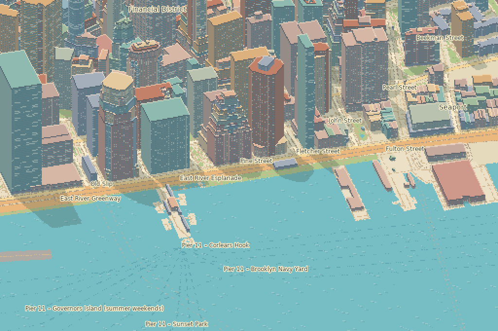

# UnoPixelMap · Pixel Atlas

[Explore the live map](https://wieslawsoltes.github.io/UnoPixelMap/)

Pixel Atlas is an interactive Uno Platform map control for the browser. It streams worldwide vector tiles and turns building footprints, height and minimum-height attributes into explorable isometric pixel art. The opening Lower Manhattan neighborhood is bundled with the app.



## Explore

Drag to pan, scroll or pinch to zoom, and right-drag to orbit and tilt. Double-click to zoom at the pointer. Click a roof, façade, street or park to inspect it. The View menu switches between overhead and isometric projection and the Day, Dusk and Night palettes. Share a view to preserve its exact camera and lighting.

Search by place name, address or decimal latitude and longitude. The city guide includes Lower Manhattan, Kraków, Shibuya, Barcelona, Paris and Singapore. With the map focused, use the arrow keys to pan, +/− to zoom, Q/E to rotate, P to switch projection, Home to return to Manhattan and Escape to clear a marker.

## Reuse the control

Reference `src/PixelMap.Controls/PixelMap.Controls.csproj` from a Skia-rendered Uno app. The browser app uses Uno.Sdk 6.7.30 on .NET 10.

```xml
<Grid xmlns:maps="using:PixelMap.Controls">
    <maps:PixelMapControl x:Name="Atlas" />
</Grid>
```

```csharp
using PixelMap.Rendering;

Atlas.Palette = PixelStyle.Dusk;
Atlas.FlyTo(new MapCamera(50.0617, 19.9373, 16.8, Bearing: -35, Pitch: 55));
Atlas.SetMarker(50.0617, 19.9373, "Rynek Główny");
```

| Project | Responsibility |
| --- | --- |
| PixelMap.Data | Bounded MVT protobuf decoding, source catalog, request coalescing, cancellation and decoded-tile LRU. Photon geocoding with an injectable endpoint. |
| PixelMap.Rendering | Wrapped Web Mercator camera, cached terrain blocks, palette shaders, orthographic building rasterization with depth-tested walls, roof holes, shaded façades, map labels and feature picking. |
| PixelMap.Controls | Uno input and accessible keyboard navigation, camera animation, camera and palette dependency properties, viewport tile scheduling and the Skia drawing surface. |
| PixelMap.App | Responsive XAML explorer, search, city guide, compass, scale, lighting and shareable camera links. |

## Build and test

```sh
dotnet workload install wasm-tools
dotnet run -c Release --project tests/PixelMap.Data.Checks
dotnet run -c Release --project tests/PixelMap.Rendering.Tests
dotnet publish src/PixelMap.App -f net10.0-browserwasm -c Release -o artifacts/browser
python3 -m http.server 8000 --directory artifacts/browser/wwwroot
```

Open http://localhost:8000/. To measure native renderer time on the bundled scene, append `-- --benchmark` to the renderer test command. The Pages workflow builds the browser app from main and publishes the static WebAssembly output.

## Sources and coverage

[OpenFreeMap](https://openfreemap.org/) serves [OpenMapTiles](https://openmaptiles.org/) vector data derived from [OpenStreetMap contributors](https://www.openstreetmap.org/copyright). See [the seed attribution and regeneration instructions](src/PixelMap.Data/Seed/README.md). Coverage and recorded building heights vary. Footprints without height data use an 8 m rendering fallback. Windows and lighting are synthesized by the renderer. The zoom-14 source tiles are overscaled for close inspection.

Address and place search uses [Photon](https://photon.komoot.io/). The public service permits moderate use. Configure a dedicated or self-hosted Photon endpoint for a high-volume deployment.
