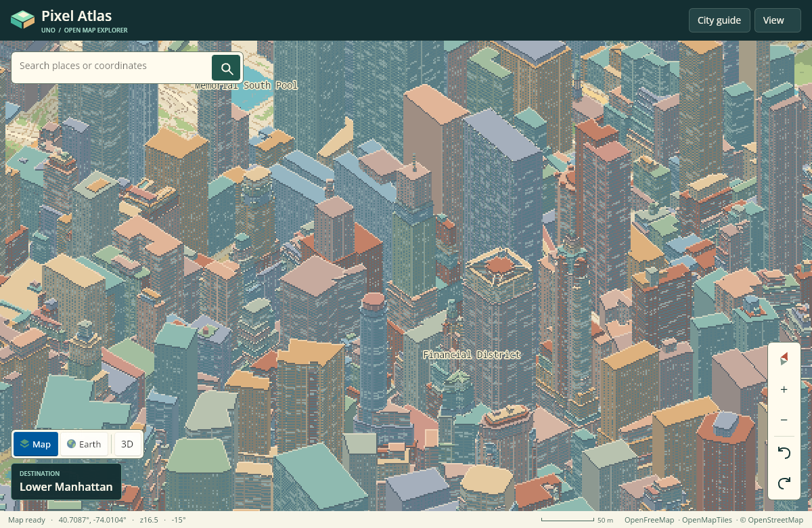
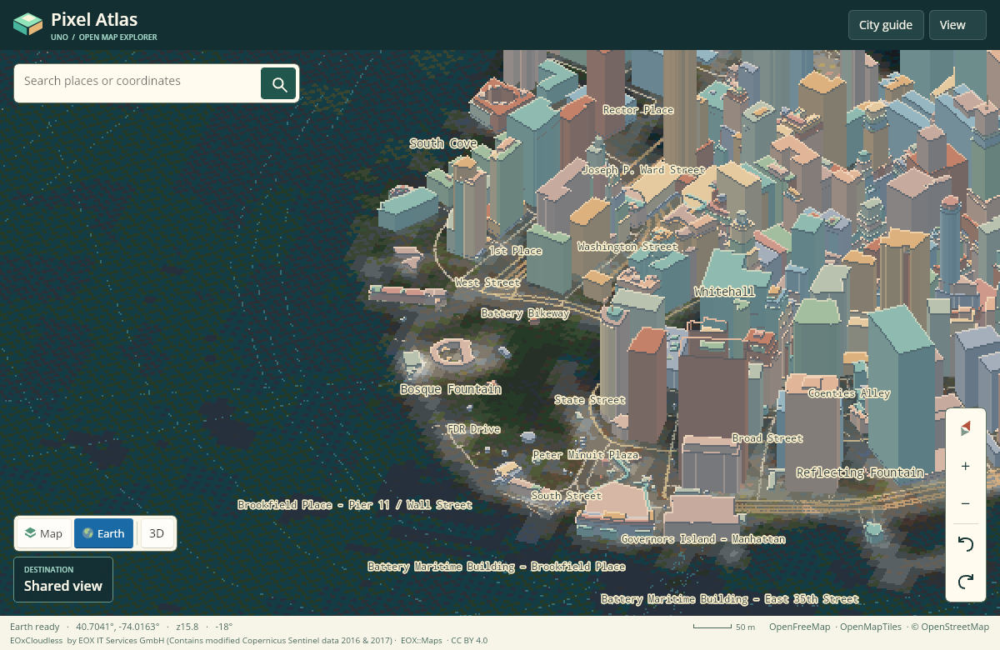
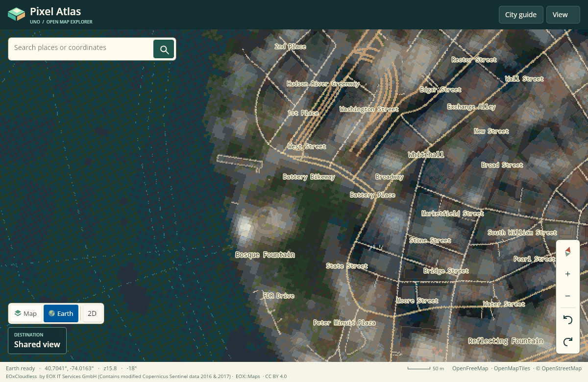

# UnoPixelMap · Pixel Atlas

[Explore the live map](https://wieslawsoltes.github.io/UnoPixelMap/) · [Lake Garda elevation](https://wieslawsoltes.github.io/UnoPixelMap/#v4/45.875000/10.850000/12.300/-25.00/58.00/Day/Elevation/Perspective/0.0/Relief/1.00) · [Earth in 3D](https://wieslawsoltes.github.io/UnoPixelMap/#v2/40.704100/-74.016300/15.750/-18.00/55.00/Day/Earth) · [Earth in 2D](https://wieslawsoltes.github.io/UnoPixelMap/#v2/40.704100/-74.016300/15.750/-18.00/0.00/Day/Earth)

Pixel Atlas is an interactive Uno Platform map control for the browser. It streams worldwide vector tiles and turns building footprints, height and minimum-height attributes into explorable pixel art. Choose an overhead, isometric or perspective camera, plan a journey, preview its directions, or explore freely on foot, in a vehicle or with a flying camera. GPU rendering and Pixel art are enabled by default. Normal, Minecraft and Roblox rendering styles are available independently of the map layer. A world overview, the opening Lower Manhattan neighborhood, northern Lake Garda terrain and six route demonstrations are bundled with the app.



[Explore the East River waterfront in detail](docs/seaport.png) · [See a live search result for Racibórz, Poland](docs/raciborz.png)

## Explore

Drag to pan, use a mouse wheel or trackpad pinch to zoom, and right-drag or Shift-drag to orbit and tilt. Continuous two-axis trackpad scrolling pans the map. Shift-scroll orbits and Alt-scroll tilts. Two touch contacts can pinch, twist, pan or tilt in parallel. Map gestures preserve the page scale and UI layout. Double-click to zoom at the pointer. Click a roof, façade, street or park to inspect it. Use Map, Earth or Elevation to choose the ground layer, then choose 2D or 3D independently. Terrain relief can be enabled for all three layers. In Pixel style, Earth transforms natural-color satellite imagery into pixel art and keeps map labels and buildings in the same coordinate system. The View menu selects rendering style, the Day, Dusk or Night palette and the perspective lens. Share a view to preserve its camera, physical eye, projection, rendering style, lighting, terrain relief and vertical exaggeration. The v5 link reader also supports v1–v4 views and preserves a free camera's eye when opened on a different viewport.

Search by place name, address or decimal latitude and longitude. The city guide includes Lower Manhattan, Kraków, Shibuya, Barcelona, Paris, Singapore and the Lake Garda mountains. With the map focused, use the arrow keys to pan, +/− to zoom, Q/E to rotate, P to switch projection, Home to return to Manhattan and Escape to clear a marker.

## Rendering styles and free roam

| Style | Terrain and buildings | Image sampling |
| --- | --- | --- |
| Pixel | Continuous terrain with palette-quantized lighting, pixel façades and roofs | Adaptive pixel-art resolution with nearest-neighbor presentation |
| Normal | Continuous terrain, smooth lighting and unprocessed Earth imagery | Full logical resolution |
| Minecraft | Quantized terrain cells with flat tops and vertical walls, stair-stepped building footprints and block materials | Pixel-art resolution |
| Roblox | Bevelled terrain blocks, simplified building forms and plastic-like shading | Full logical resolution |

Perspective Pixel windows now retain their average glass and lamp contribution as façades become distant or turn away from the camera. Well-resolved nearby windows keep their original pixels. [Algorithm, visual comparison and measured cost](docs/pixel-window-filtering.md)

Open **Play** to start a route-independent session at the map center. Walk, car, bicycle, boat, aircraft and train share the fixed-step simulation, terrain sampling, collision world, audio and effects. Free flight provides an independent camera with forward, lateral and vertical movement plus yaw and pitch. Changing vehicles retains the current geographic position. Trains attach to nearby mapped tracks, follow connected segments, and wait for additional track coverage where continuation is unavailable. Boats wait on dry or uncovered starts and resume when navigable water is available. The route planner remains available after leaving free roam.

Third-person chase, first-person, cockpit, orbit and north-up rigs follow the active vehicle. First-person cameras use metre-scaled eye heights and an 8 cm near plane. Perspective pitch extends through the horizon toward an upward view, and longitude wraps around the globe. The projection retains Web Mercator's latitude boundary. Terrain-relative camera clearance uses the rendered surface, including block-style steps, while vehicle physics uses the underlying elevation data.

| Free-roam input | Action |
| --- | --- |
| W/S or ↑/↓ | Forward and reverse, or aircraft throttle |
| A/D or ←/→ | Walk/free-flight strafe, vehicle steering |
| Q/E | Walk/free-flight yaw |
| Drag or right touch stick | Look and orbit |
| Click the map in first person | Capture relative mouse movement |
| Space | Jump on foot, brake a vehicle, ascend in free flight |
| Page Up / Page Down | Climb and descend |
| Shift | Run or boost |
| C | Toggle first-person and third-person view |
| R | Respawn at the session origin |
| Escape or P | Pause or resume, releasing captured mouse input |
| Left touch stick | Independent movement while the right stick controls look |

Mouse-wheel zoom changes chase distance. In free flight it changes movement speed. Pausing, changing modes, hiding the page or leaving the game releases held inputs. Sound remains opt-in through the game's sound control.

## Journeys and driving

[Drive through Manhattan](https://wieslawsoltes.github.io/UnoPixelMap/#journey/drive) · [Ride the subway](https://wieslawsoltes.github.io/UnoPixelMap/#journey/train) · [Cross the East River](https://wieslawsoltes.github.io/UnoPixelMap/#journey/boat) · [Fly between airports](https://wieslawsoltes.github.io/UnoPixelMap/#journey/flight) · [Cycle](https://wieslawsoltes.github.io/UnoPixelMap/#journey/bike) · [Walk](https://wieslawsoltes.github.io/UnoPixelMap/#journey/walk)

Open Journeys to choose a travel mode and edit 2–24 ordered stops. Search for a stop, enter its coordinates or pick it on the map. Stops can be reordered, reversed and removed. Two-stop walking, cycling and driving requests expose alternative routes when the provider supplies them. The itinerary includes per-leg distance, duration, turn instructions and roundabout exits. Preview compresses the journey into a 12–80 second tour with pause, scrubbing and adjustable playback speed. The next maneuver updates with distance along the route. Manual driving displays speed from the vehicle simulation.

Take manual control to start a checkpoint challenge. Each vehicle has its own acceleration, braking, drag, steering response, sprite animation and synthesized sound. The train follows its track, the boat carries turning inertia, and the aircraft supports throttle-dependent lift and altitude. Mapped building and shoreline contacts constrain free movement. Ordered gates award points, and recovery returns the vehicle to its last checkpoint. Cruise follows the planned path. Chase, north-up, cockpit and orbit camera rigs keep the vehicle in the usable viewport beside the journey panel.

| Input | Action in manual mode |
| --- | --- |
| W or ↑ | Throttle |
| A/D or ←/→ | Steer |
| S, ↓ or Space | Brake |
| Page Up / Page Down | Aircraft climb / descend |
| H | Horn or signal |
| On-screen pad | Touch throttle, steering, brake and aircraft lift |

Sound starts muted and is activated by the sound button. The Web Audio mixer synthesizes motors, wind, wheel rhythms, footsteps, horns and checkpoint cues. It suspends on pause and when the document is hidden. Each map has an independent, disposable audio graph.

Road routes use separate FOSSGIS OSRM foot, bicycle and car networks. Train and boat routes follow connected mapped tracks, ferry lines or fairways within a bounded local corridor. Their times are estimates. Flight routes follow great-circle courses. Timetables, passenger transfers, vessel clearance, flight procedures, live traffic and photogrammetric city meshes require additional data providers. The simulation uses mapped geometry with simplified vehicle dynamics. [Routing coverage and source details](src/PixelMap.Routing/README.md)

## How Earth becomes pixel art

| Earth in 3D | Earth in 2D |
| --- | --- |
|  |  |

The renderer decodes each satellite tile once. It averages colors in linear light, merging low-contrast 2×2 areas while retaining individual high-contrast samples along shorelines and field boundaries. It selects neighboring colors from an 89-color palette in OKLab and applies a world-aligned 4×4 ordered dither. Panning or rotating leaves that pattern attached to the ground.

Zoom levels 13 and 14 preserve the full 256×256 source grid. Lower zoom levels use 128×128 art tiles. A 24 MiB LRU holds processed textures. In overhead view, translucent building footprints preserve the imagery underneath. Tilting into the isometric projection reveals the extruded walls.

[Explore Lake Garda in Earth mode](https://wieslawsoltes.github.io/UnoPixelMap/#v2/45.687000/10.737000/13.000/30.00/55.00/Day/Earth) · [View the Lake Garda browser capture](docs/earth-lake-garda.png) · [See Earth on a phone-sized viewport](docs/earth-phone.png)

## Elevation and terrain relief

[Explore the pixel-art elevation map](https://wieslawsoltes.github.io/UnoPixelMap/#v4/45.875000/10.850000/12.300/-25.00/58.00/Day/Elevation/Perspective/0.0/Relief/1.00) · [Explore Earth over the same mountains](https://wieslawsoltes.github.io/UnoPixelMap/#v4/45.875000/10.850000/12.300/-25.00/58.00/Day/Earth/Perspective/0.0/Relief/1.00)

Elevation combines altitude colors with quantized hill shading and the existing map artwork. **Terrain relief** in View lifts the ground into a real height field for Map, Earth and Elevation. **Camera angles and orbit** includes a 1×–4× vertical exaggeration slider. Altitude readouts report unexaggerated metres above sea level. Overhead and oblique projections, camera orbit, feature inspection and saved views share these settings.

Mapzen Terrain Tiles provide worldwide, keyless Terrarium elevation data. The decoder retains signed heights and bilinearly samples adjoining tiles, with loaded parents and a world overview supplying progressive coverage. A bounded screen-adaptive quadtree stitches neighboring mesh edges and projects cached pixel artwork with perspective-correct texture coordinates. Buildings, labels, routes, vehicle effects and picking share terrain depth. Building height and vehicle clearance retain their physical scale above the terrain.

Ground vehicles and trains follow the sampled surface. Ocean surfaces use sea level, while land and inland water retain signed DEM elevations. Aircraft use absolute altitude and terrain-relative clearance, with swept ground contacts, taxiing and landing handling. Rendered navigation objects follow the selected mesh while the simulation retains physical DEM heights. The camera keeps a local terrain datum, supports terrain-anchored gestures and adjusts perspective eye clearance above slopes.

The default GPU backend renders terrain and buildings with retained geometry, vertex and fragment shaders, and hardware depth testing. Sparse CPU visibility queries keep labels, routes, vehicles and feature inspection aligned with the selected mesh. The CPU renderer remains available through the same control. Source DEM detail varies by region, and the height field uses adaptive sampling at the current art resolution. [Elevation provider, fixtures and attribution](src/PixelMap.Data/Elevation/README.md)

Building meshes use lossless 32-byte vertices and exact output allocation. On the captured dense Manhattan corpus, this reduces constructor allocation by 53.6% and retained mesh/edge payload by 146.3 MB while preserving the original geometry and rendered pixels. [Mesh layout and memory evidence](docs/building-mesh-memory.md) · [Current measurements and limitations](docs/performance.md)

## Reuse the control

Reference `src/PixelMap.Controls/PixelMap.Controls.csproj` from a Skia-rendered Uno app. The browser app uses Uno.Sdk 6.7.30 on .NET 10.

Browser hosts using Uno 6.7.135 also include the GL readback adapter and its linker flag. It supplies asynchronous WebGL2 pixel-pack transfers and BGRA compatibility for synchronous capture. Adjust the source path to the referenced control project. The adapter targets Uno 6.7's resolver behavior and needs verification when upgrading Uno.

```xml
<PropertyGroup>
    <UnoFeatures>SkiaRenderer;Skia;GLCanvas</UnoFeatures>
    <EmccExtraLDFlags Condition="'$(TargetFramework)' == 'net10.0-browserwasm'">$(EmccExtraLDFlags);-Wl,--wrap=uno_gl_resolve</EmccExtraLDFlags>
</PropertyGroup>
<ItemGroup>
    <WasmShellNativeCompile Include="../PixelMap.Controls/Browser/pixel_map_gl_readback.c"
                            Condition="'$(TargetFramework)' == 'net10.0-browserwasm'" />
    <Content Include="../PixelMap.Controls/Browser/map-input.js"
             Link="input/map-input.js" UnoDeploy="Root" CopyToOutputDirectory="PreserveNewest" />
</ItemGroup>
```

Load `input/map-input.js` before Uno's bootstrap script in the browser host. The adapter preserves native trackpad deltas, scopes browser gesture cancellation to the map after XAML hit testing, manages pointer capture and releases input on focus loss.

```xml
<Grid xmlns:maps="using:PixelMap.Controls">
    <maps:PixelMapControl x:Name="Atlas" />
</Grid>
```

```csharp
using PixelMap.Rendering;

Atlas.IsEarthImageryEnabled = true;
Atlas.IsTerrainEnabled = true;
Atlas.IsGpuRenderingEnabled = true;
Atlas.TerrainExaggeration = 1;
Atlas.Palette = PixelStyle.Dusk;
Atlas.RenderStyle = MapRenderStyle.Pixel;
Atlas.FlyTo(new MapCamera(50.0617, 19.9373, 16.8, Bearing: -35, Pitch: 55));
Atlas.SetMarker(50.0617, 19.9373, "Rynek Główny");
```

```csharp
using PixelMap.Controls;
using PixelMap.Routing;

var planner = new RoutePlanner(httpClient, Atlas.VectorTiles);
var route = await planner.PlanAsync(TravelMode.Drive,
[
    new RouteStop("Wall Street", new RoutePoint(40.7068, -74.0090)),
    new RouteStop("City Hall", new RoutePoint(40.7128, -74.0060))
], cancellationToken);

Atlas.ShowRoute(route);
Atlas.CameraRig = JourneyCameraRig.Chase;
Atlas.Journey.Preview();
```

```csharp
using PixelMap.Controls;
using PixelMap.Rendering;
using PixelMap.Routing;
using PixelMap.Simulation;

Atlas.RenderStyle = MapRenderStyle.Minecraft;
Atlas.IsTerrainEnabled = true;
Atlas.StartFreeRoam(TravelMode.Walk);
Atlas.CameraRig = JourneyCameraRig.FirstPerson;
Atlas.SetFreeRoamInput(new FreeRoamInput(Forward: 1, Boost: true));
Atlas.LookFreeRoam(bearingDelta: 15, pitchDelta: -5);
// A gamepad adapter can update this input independently of held keyboard controls.
Atlas.SetFreeRoamInput(default);
```

`IRouteProvider` supplies additional routing backends. `VehicleProfile` defines compatible vehicle dynamics, and `JourneySession.SelectVehicle` installs a profile for the current route. `IJourneyWorld` supplies collision rules and surface heights. `ElevationTileSource` accepts a custom HTTPS Terrarium XYZ provider, and `ElevationSnapshot` supplies raw and water-aware height sampling. `IJourneyAudioDevice` supplies an audio backend. The browser host deploys `PixelMap.Audio/Browser/journey-audio.js` and attaches a `BrowserAudioDevice`. Other hosts can use the same simulation without browser audio.

| Project | Responsibility |
| --- | --- |
| PixelMap.Data | Bounded MVT protobuf decoding, source catalog, request coalescing, cancellation and separate byte-bounded caches for vector tiles, satellite imagery and elevation. Bounded Terrarium PNG decoding, immutable height snapshots and indexed water surfaces. Photon geocoding with an injectable endpoint. |
| PixelMap.Rendering | Wrapped Web Mercator camera, cached terrain blocks, palette shaders, orthographic and perspective rendering, depth-tested walls and roof holes, map labels, feature picking, route overlays, vehicle sprites and world-anchored particles. The GPU terrain backend uses retained GL geometry, hardware depth, pixel shaders and sparse overlay visibility queries. Terrain relief shares the adaptive stitched height field across both backends. |
| PixelMap.Routing | Provider-separated routes and alternatives, bounded local A* rail/ferry searches, great-circle flight paths, ordered stops, maneuver metadata and shared provider-distance route sampling. |
| PixelMap.Simulation | Fixed 60 Hz clock, vehicle profiles, free roaming and flight, jumping, rail following, manual inputs, preview transport, cruise, checkpoint scoring and recovery, spatially indexed mapped collisions and replaceable world rules. |
| PixelMap.Audio | Coalesced motion parameters and discrete cues through an injectable sound device. The browser adapter owns a bounded Web Audio graph and releases completed transient sounds. |
| PixelMap.Controls | Uno input and accessible keyboard navigation, scoped browser gestures, physical-eye cameras and follow rigs, viewport tile scheduling, journey orchestration, and retained GPU presentation through Skia with a GLCanvasElement fallback. Pixel styles adapt resolution to measured frame cost and return to 2-DIP pixels at rest. |
| PixelMap.App | Responsive XAML explorer, search, city guide, compass, scale, lighting, shareable camera links, journey planner and free-roam HUD with independent movement/look sticks. |

## Rendering backends

The View menu includes **GPU rendering**, enabled by default. Terrain, free-camera views and the additional styles use a retained WebGL2/OpenGL ES 3 renderer. In supported browser Skia canvases, it draws on the compositor's graphics context and presents retained artwork textures directly. Uno's `GLCanvasElement` supplies a separate-context fallback. Vertex shaders project the stitched height field, instanced terrain blocks and extruded building meshes. Fragment shaders implement each style's lighting and materials while preserving elevation colors, façade details, roof edges and overhead Earth blending. A depth attachment resolves terrain and building occlusion at the selected style's resolution. Pixel styles use nearest-neighbor presentation.

Terrain artwork, height buffers and building meshes remain cached across camera movement. Tile-priority reordering preserves those textures. Face indices and roof-rim vertices are reused independently when only the other stream changes. A 48 MiB texture-cache budget can retain up to 192 GPU-only artwork tiles, with exact CPU reconstruction when needed. Building foundations follow the same selected terrain triangles used by picking. Conservative bounds prepare exact visibility geometry only where labels, picking or overlays query it; cheap label rejection precedes occlusion when ordering permits. Depth-index membership buffers have a 16 MiB active capacity limit and retain exact queries through a bounded fallback. [Visibility algorithm and measured preparation costs](docs/sparse-visibility.md)

The direct browser path retains at most two outstanding GPU submissions and presents their textures without framebuffer readback. The separate-context fallback queues art-resolution transfers into two pixel-pack buffers and copies only after a signaled, zero-timeout GPU-fence poll. Both paths coalesce pending camera changes and pair retained artwork with its labels, terrain picking, markers, route graphics, gates, sprites and effects. Overlays render at native DPI, and overlay-only animation reuses the terrain image. Resources are released on unload and GPU initialization failures select the CPU renderer.

Flat Pixel views retain the GPU-backed Skia path using `SKVertices` and `SKRuntimeEffect`. The status bar reports **GPU active** or **CPU fallback** when the option is selected. The control exposes `IsGpuRenderingEnabled`, `IsGpuRenderingActive` and `RenderStyle`. CPU and GPU rasterization can differ at primitive boundaries and in color rounding. Artwork contains approximately 4×, 9× or 16× fewer pixels at pixel sizes 2, 3 and 4; the fallback transfers artwork at those same dimensions. Performance measurements distinguish CPU preparation, GL work, presentation and browser scheduling. [Performance methodology and results](docs/performance.md)

## Build and test

```sh
dotnet workload install wasm-tools
dotnet run -c Release --project tests/PixelMap.Data.Checks
dotnet run -c Release --project tests/PixelMap.Rendering.Tests
dotnet run -c Release --project tests/PixelMap.Routing.Tests
dotnet run -c Release --project tests/PixelMap.Simulation.Tests
node tests/browser/audio.cjs
node tests/browser/input-adapter.cjs
dotnet publish src/PixelMap.App -f net10.0-browserwasm -c Release -o artifacts/browser
python3 -m http.server 8000 --directory artifacts/browser/wwwroot
```

Open http://localhost:8000/. Append `-- --benchmark --output artifacts/rendering` to the renderer test command for fixed-resolution timing and exact image hashes across the bundled scene, camera modes, palettes and vehicle journeys. Add `--visual-only` to capture images without timing, `--filter persp65` to select cases, or `--compare path/to/baseline/report.json` to check a previous capture. The routing tests use deterministic data by default. Append `-- --live` for explicit public-provider integration checks.

```sh
npm ci --prefix tests/browser
(cd tests/browser && npx playwright install chromium)
node tests/browser/smoke.cjs http://localhost:8000/
node tests/browser/journeys.cjs http://localhost:8000/
node tests/browser/terrain.cjs http://localhost:8000/
node tests/browser/explore.cjs http://localhost:8000/
node tests/browser/performance.cjs http://localhost:8000/ artifacts/browser-visual --visual
node tests/browser/performance.cjs http://localhost:8000/ artifacts/browser-motion --motion
node tests/browser/performance.cjs http://localhost:8000/ artifacts/browser-gpu --motion --gpu
node tests/browser/performance.cjs http://localhost:8000/ artifacts/terrain-gpu --motion --gpu --terrain
```

On Linux with EGL and Mesa installed, the opt-in GLES checks exercise compiled terrain and building shaders, hardware depth, CPU/GPU image comparisons, navigation overlays, retained-frame lifetime and high-DPI composition. Add `--gpu-benchmark` for fixed-resolution CPU/GPU timings that include synchronous framebuffer readback.

```sh
LIBGL_ALWAYS_SOFTWARE=1 EGL_PLATFORM=surfaceless dotnet run -c Release \
  --project tests/PixelMap.Rendering.Tests -- --gpu-terrain --gpu-benchmark \
  --gpu-output=artifacts/gpu-terrain
```

The Pages workflow builds the AOT-enabled browser app from main, runs the engine checks, exercises the exact publish artifact with Chromium, and publishes it after verification. Journey browser checks cover all six modes, route alternatives, waypoint picking, perspective projection, manual keyboard/touch inputs and Web Audio activation. Terrain browser checks exercise the Garda fixtures, all three layers, overhead and perspective, orbit, dragging, elevation inspection, exaggeration, saved views and handset layout. Exploration checks exercise default GPU rendering, four styles, page-scale-preserving gestures, pointer lock, free movement, camera switching and simultaneous touch sticks. Map, journey and terrain checks run with CPU and GPU modes in CI. Set `PIXELMAP_SHOTS` to save browser captures.

## Sources and coverage

[OpenFreeMap](https://openfreemap.org/) serves [OpenMapTiles](https://openmaptiles.org/) vector data derived from [OpenStreetMap contributors](https://www.openstreetmap.org/copyright). See [the seed attribution and regeneration instructions](src/PixelMap.Data/Seed/README.md). Coverage and recorded building heights vary. Footprints without height data use an 8 m rendering fallback. Windows and lighting are synthesized by the renderer. The zoom-14 source tiles are overscaled for close inspection.

Earth uses the EOxCloudless 2016 mosaic from EOX IT Services GmbH, containing modified Copernicus Sentinel data from 2016 and 2017. Each tile is processed for the pixel-art view. Imagery has approximately 10 m source resolution. Buildings and labels use independent vector data, so features can differ between acquisition dates. The app includes imagery for the world overview, its Manhattan opening and northern Lake Garda. [EOxCloudless](https://cloudless.eox.at/) · [CC BY 4.0](https://creativecommons.org/licenses/by/4.0/) · [Imagery attribution and source](src/PixelMap.Data/Imagery/README.md).

Address and place search uses [Photon](https://photon.komoot.io/). The public service permits moderate use. Configure a dedicated or self-hosted Photon endpoint for a high-volume deployment.
