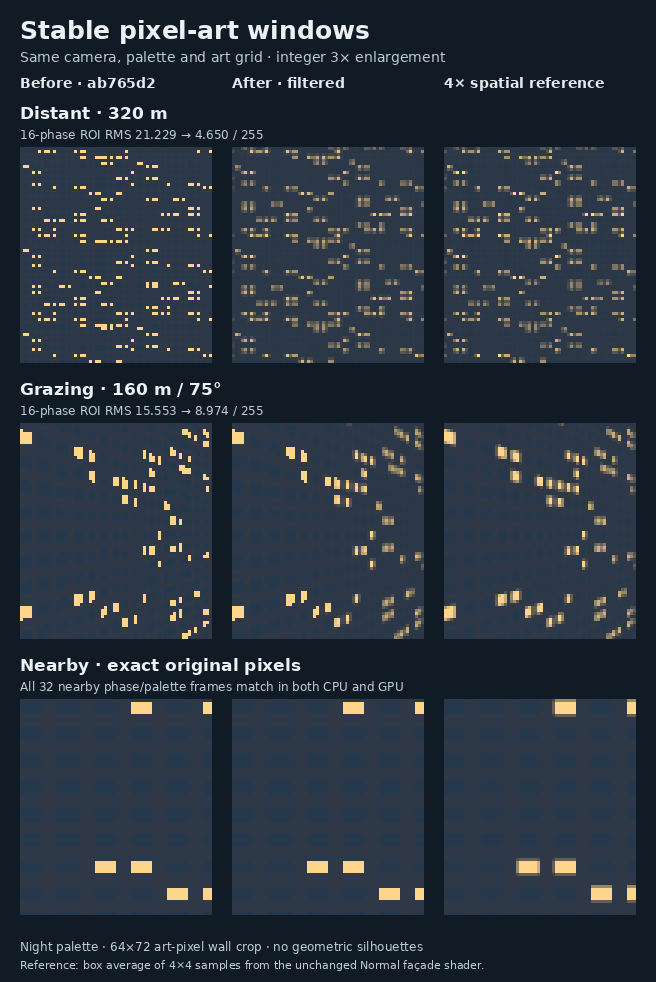

# Stable pixel-art façade windows

Perspective Pixel windows now account for the area covered by an artwork pixel. Nearby windows retain their original palette decisions; distant and grazing façades retain their average glass and lamp contribution without the previous point-sampling pattern. Normal, Minecraft, Roblox, orthographic buildings, terrain, roofs and roof rims keep their existing treatment.

The implementation is in [PixelWindowFilter.cs](../src/PixelMap.Rendering/PixelWindowFilter.cs), [the building shaders](../src/PixelMap.Rendering/GlMapShaders.cs), and [the CPU perspective rasterizer](../src/PixelMap.Rendering/BuildingRasterizer.Perspective.cs). The change adds no rendering pass and no full-resolution intermediate surface.

## Why the previous windows aliased

The previous perspective shader sampled a rectangular window pattern at one point per art pixel. Its distance check considered pixels per metre, but did not consider how strongly a wall was foreshortened. A grazing wall could pass the check while several window bays projected into a single art pixel. Small camera movements then selected different glass, lamp and wall samples. Beyond the distance threshold, the windows disappeared completely.

The new filter uses the screen footprint of both façade coordinates: distance along the wall and height above its foundation. These are evaluated in **art pixels**, before nearest-neighbor presentation enlarges the artwork. Consequently, changing the requested pixel size changes the filtering footprint consistently on CPU and GPU.

## Coverage and lighting

Let `q = 1/W` and let `U` be a façade coordinate in metres. `U*q` and `q` are affine across a projected triangle, so its screen derivative is:

```text
dU/dx = (d(U*q)/dx - U*dq/dx) / q
```

The same expression gives the other screen derivative and the vertical façade coordinate. The filter uses the sum of their absolute values to estimate one art pixel's footprint along each façade axis, then divides by the existing bay and story dimensions. This is an axis-aligned bound of the local linearization; perspective derivatives can vary across the finite pixel. The shader evaluates these derivatives before any varying-dependent branch or discard. The CPU uses the corresponding rational interpolation planes.

The rectangular window remains at its original position within each room: horizontal range `0.17–0.76` and vertical range `0.23–0.75`. An analytical periodic integral measures how much of each interval overlaps the art pixel. Whole periods and the two partial end intervals are evaluated separately to avoid subtracting large, almost equal accumulated values. Multiplying the two coverages gives the window's area fraction within the axis-aligned footprint.

Lamp choices still come from the original deterministic room sequence, indexed by `(seed + column + story * 16) & 255`. A 256-by-16 RG8 texture repeats this sequence over the façade. Its red channel preserves the original room lookup; its green channel contains lamp coverage. All nine mip levels are generated once from the original samples, with one byte rounding per level, rather than repeatedly rounding an already rounded parent level. The complete texture occupies **10,942 bytes** and is shared by all building draws on that renderer.

For footprints no wider than one room along either axis, at most four rooms contribute. The bilinear lookup coordinates are weighted by their actual window intersections, so the lamp weights correspond to those four covered areas. Larger footprints use the lamp mip pyramid. Between one and two rooms per pixel, the lookup moves smoothly from the weighted room coordinates to the pixel's actual façade position.

The maximum footprint controls the transition from the original point sample:

- At or below `0.2` rooms per art pixel, the original window and lamp decision is used exactly.
- Between `0.2` and `0.5`, a smooth transition introduces the covered-area result.
- At or above `0.5`, the covered-area result supplies the window contribution.

The color arithmetic remains in the palette's existing 8-bit RGB code-value space. This preserves the renderer's existing color convention; it does not introduce a new linear-light or tone-mapping pipeline.

### Approximation limits

The footprint uses an axis-aligned bound of the projected art pixel's local linearization in façade coordinates. It is not an exact integration over the rotated projective footprint. The lamp mip selection is also isotropic: it uses the larger footprint dimension. On a strongly grazing wall this can average some lamp variation between stories that are still resolved vertically. Window coverage is evaluated separately on each axis, so the story and bay pattern is not replaced by a uniformly colored wall.

These choices keep the minified path to one filtered lamp lookup, palette lookups and scalar coverage arithmetic. They avoid a multisample loop or a separate screen pass. The measurements below quantify both their remaining error and their cost.

## CPU fallback optimization

The CPU rasterizer prepares palette vectors once per wall triangle and blends RGB channels with `Vector4`, preserving the scalar arithmetic order and byte rounding. An independent copy of the original scalar filter checks 65,536 samples across palettes, signed room boundaries, transition thresholds, mip levels and large façade coordinates. Both the ordinary and precomputed-footprint entry points must return exactly the original bytes.

A conservative triangle test also avoids filtering work when every possible rasterized sample has a footprint at or below 0.2 rooms. It bounds the affine reciprocal-W, U/W and Z/W planes over the viewport's pixel-center rectangle. The bound includes float row initialization and up to one viewport width of rounded scanline additions. It then bounds the rational derivative without relying on cancellation. Near-plane cases, nonfinite values, unsafe denominators, overflow and threshold uncertainty retain the general pixel path. The numerical regression checks 405,674 actual float-accumulated samples in 291 accepted bounds and 221 general-path cases; 32 complete nearby canvases retain frozen original hashes.

For a finite wall with exactly constant reciprocal W, both footprint dimensions, the lamp mip level and filter transition are constant across the triangle. These values are evaluated once. Varying-perspective walls still evaluate the original quotient derivatives per pixel. The implementation retains the original multiplication/division association to preserve floating-point results.

For footprints spanning at least two rooms, the lamp-coordinate blend is exactly one. When the finite coordinate has absolute value at least two, its weighted centroid has the same sign and lies within the factor-of-two condition for exact floating-point subtraction. The original centroid-plus-difference expression therefore returns the coordinate exactly, allowing the centroid calculation to be skipped. Smaller and exceptional coordinates keep the original expression.

### Preparing a constant scanline once

The prepared-row specialization reuses the vertical sampling work across an
eligible scanline. It keeps the existing filter and palette arithmetic; it does
not approximate the story coordinate or reuse a result across different rows.
Eligibility starts with the existing finite-attribute proof and **exactly zero**
horizontal and vertical reciprocal-W gradients. Both prepared footprint
dimensions must remain finite. The row additionally requires an exactly zero
horizontal `Z/W` gradient, a nonzero initial `Z/W` numerator, and a nonempty pixel
interval. `TryFilteredWindowRow` checks that the resulting altitude and story
coordinate are finite before using the specialization.

These conditions make the reciprocal W, altitude and story coordinate identical
at every sample on that row. A `SamplingRow` then prepares:

- Vertical periodic window coverage and the story-coordinate lamp lookup.
- Point-window eligibility and the original wrapped story/seed offset.
- Mip-row indices, the vertical bilinear weight, and the inter-level blend.

Each covered pixel still computes its horizontal coordinate from the original
`U/W` accumulator. That accumulator advances with the same repeated float
addition, including after an occluded pixel; it is not replaced with a
start-plus-index multiplication. Horizontal coverage, the two horizontal
bilinear blends, vertical interpolation, mip interpolation, palette mixing and
final byte rounding retain their original operation order. The prepared state
contains value fields and references to the existing mip arrays; it creates
no per-row array or heap cache.

Zero numerators use the general path because repeatedly adding zero can change
the sign of negative zero. A varying story coordinate, varying reciprocal W,
nonfinite derived value or failed finite-footprint proof likewise keeps the
existing per-pixel path. These are semantic guards, not tolerances for deciding
that a wall is approximately front-facing.

The row body is isolated in a method marked `MethodImplOptions.NoInlining`.
This keeps its mip-row state and specialized sampling loop out of the ordinary
`WallTriangle` method's compiled body. The first prototype placed this work in
the existing wall loop and regressed the native-resolution nearby fixture by
11.06%; that result is retained in the
[rejected-prototype record](verification/pixel-row-rejected-prototype-20261107.json).
The final helper has its own confirmation below, including its smaller residual
regression. The prototype and confirmation are separate measurements.

The unchanged scalar oracle now checks all entry points, including prepared
rows, over **65,536 random/boundary samples**. Another **222,912 comparisons**
reuse each prepared row over 129 changing horizontal coordinates, covering
signed story/window boundaries, exact transition neighbors, mip extents and
periodic lamp indices. These additions leave the earlier 405,674-sample
footprint-bound check and frozen nearby-image checks in place.
[Row/scalar regression implementation](../tests/PixelMap.Rendering.Tests/PixelWindowColorChecks.cs)

## Quality evidence



The fixture renders the same wall from nearby, distant, grazing and far viewpoints in Day and Night palettes. Each case moves through 16 camera phases. The logical viewport is 768 by 576, with 192-by-144 artwork at pixel size 4. The reference is a box average of 4-by-4 samples from the unchanged Normal façade shader. This is a finite spatial reference, not a claim of exact continuous reconstruction.

Measurements use the same **64-by-72 art-pixel wall region** shown in the figure: `x = 32..95`, `y = 36..107`. The crop excludes sky, roof rims and geometric silhouettes. RGB RMS measures per-channel difference from the spatial reference. Temporal RMS compares each successive frame difference with the corresponding reference difference. Mean brightness bias is the absolute difference between the cropped means, averaged across phases, using `0.2126 R + 0.7152 G + 0.0722 B` on 8-bit code values. This is a luma metric without linear-light conversion; the raw JSON field is named `MeanLuminanceError`.

| Night fixture | RGB RMS, original → filtered | Temporal RMS, original → filtered | Mean brightness bias, original → filtered |
| --- | ---: | ---: | ---: |
| Distant, 320 m | 21.229 → 4.650 | 17.505 → 4.532 | 0.359 → 0.088 |
| Grazing, 160 m / 75° | 15.553 → 8.974 | 15.461 → 10.239 | 0.449 → 0.220 |
| Far, 720 m / 20° | 19.363 → 6.754 | 4.985 → 4.653 | 9.677 → 0.153 |

Across Day and Night, distant RGB error falls by 77.5–78.1%, grazing error by 36.6–42.3%, and far error by 65.1–69.5%. The smaller temporal improvement in the far fixture should be read alongside its brightness result: the old distance cutoff removed window detail, which can produce a stable but incorrect image. The new result retains that contribution. [All quality measurements and identities](verification/pixel-window-quality.csv)

All 32 nearby camera-phase/palette frames preserve the complete 192-by-144 artwork hashes on both CPU and GPU: 64 exact baseline comparisons. The independent tests also cover 4,096 signed and periodic window intersections, lamp mip averages, and 2,048 exact resolved samples. CPU/GPU mean channel difference in the filtered fixtures is at most 0.052 byte levels across the diagnostic and integrated checks. [Regression and diagnostic implementation](../tests/PixelMap.Rendering.Tests/PixelWindowChecks.cs)

The integrated native GLES suite passes its existing checks, including all four rendering styles, 64 culling comparisons, 108 physical-camera visibility comparisons, 32 cache-pressure frames, retained images, context recreation, picking and the 48 standard CPU/GPU rendering cases. Comparing that standard report with the original renderer leaves 30 cases and all their 120 image hashes unchanged. The 18 changed cases are precisely the perspective-building cases across three palettes, three art scales and two pitches. Existing structural tolerances were retained.

### Prepared-row quality preservation

The prepared-row pass compares against the already filtered `c937ddd` renderer,
so its quality requirement is to preserve that output. All **128 CPU phase
hashes and 128 GPU phase hashes** match their respective baseline captures,
and every non-timing field in the eight Day/Night quality results is unchanged.
This is equality between source variants within each backend; the existing
small CPU/GPU differences in the filtered fixtures remain as measured above.

The independent audit also decodes all 24 saved phase-zero PNG pairs: CPU,
GPU and spatial-reference captures for the eight fixtures. Their encoded bytes
and decoded RGBA hashes match. Other phases are checked through their recorded
hashes, and the audit does not treat the functional capture's submission times
as performance evidence.
[Quality audit and metrics](verification/pixel-row-quality-20261107.json) ·
[Complete benchmark/quality hash list](verification/pixel-row-image-hashes-20261107.csv)

The complete selected renderer, including subsequent selective depth indexing,
also retains a byte-identical standard GLES `checks.json` against `c937ddd`.
That is a separate integrated validation, recorded in the
[final GLES audit](verification/gles-final-20261107-audit.json), rather than a
replacement identity for the frozen helper binary used in the CPU timing below.

## Isolated shader cost

The filtering improves quality at a measurable shader cost. The cost fixture deliberately covers almost the entire viewport with one wall. It compares two instances of the same current renderer, with identical geometry, room textures, culling and retained camera frames. A test-only shader-source interceptor replaces the minification branch with `false` for the point-sampled control; the compiler removes its unused footprint calculations. Its four control images match the frozen original renderer's corresponding images exactly. [Cost harness](../tests/PixelMap.Rendering.Tests/PixelWindowChecks.Benchmark.cs)

The run uses .NET 10.0.14, an AMD EPYC 9V74, Mesa 25.0.7 llvmpipe with LLVM 19.1.7, CPU affinity 0, two managed processors, two llvmpipe threads and disabled tiered compilation. Each scene runs four blocks in point / filtered / filtered / point order. Each block has 16 warmups and 64 timed draws. The table uses the upper-middle value of the 128 samples per variant. Timings include warm GL submission and `glFinish` completion; frame preparation and framebuffer readback are outside the timed interval.

| Wall fixture | Point median | Filtered median | Added time | Change |
| --- | ---: | ---: | ---: | ---: |
| Nearby, pixel size 4 | 1.450 ms | 1.461 ms | 0.011 ms | +0.8% |
| Distant, pixel size 4 | 1.878 ms | 2.019 ms | 0.141 ms | +7.5% |
| Grazing, pixel size 4 | 1.669 ms | 1.891 ms | 0.222 ms | +13.3% |
| Far, pixel size 4 | 2.385 ms | 2.880 ms | 0.495 ms | +20.8% |
| Nearby, native artwork resolution | 19.571 ms | 20.635 ms | 1.063 ms | +5.4% |

Both filtered blocks show the added cost in the minified cases. The far fixture's p95 rises from 2.828 to 3.447 ms. These are software-renderer stress measurements, not application frame times or displayed-frame-rate results. The native-resolution nearby case also exposes the derivative work when no filtering is needed. Physical-GPU and browser timing require separate measurement. [All 1,280 timing samples, source hashes and draw/upload counts](verification/pixel-window-shader-cost.csv)

The quality baseline is commit `ab765d24c3063c1745867772426720fd47152805`. The quality and isolated-cost snapshots include different stages of unrelated depth work; their exact assembly hashes are recorded separately. The isolated control keeps those changes identical within each comparison, and its image hashes verify the original point-sampled behavior.

## Current CPU confirmation: prepared rows

The final helper comparison uses the unchanged `c937ddd` rendering assembly
as its baseline and the frozen prepared-row assembly with SHA-256
`ea5ba63b56be5ecdece04fbf7914f74c3fdac89acffcbc1623c18e965e760929`
as its candidate. The identical compiled public-API harness and all Data,
Routing, Skia and native dependency files are verified byte-for-byte; only
`PixelMap.Rendering.dll` differs. Source SHA-256 and Git blob identities for the
three owned files are included in the evidence, independently of commit
metadata used when publishing the source.

This measures complete CPU `PixelMapRenderer.Draw` plus `SKCanvas.Flush` into
an RGBA bitmap. The five label-free wall fixtures use flat terrain, the Night
palette, a 768 × 576 viewport and 16 moving camera phases. Geometry preparation,
CPU rasterization and nearest artwork presentation are included; retained
picture reuse cannot bypass the changing-camera draw. Fixture construction,
image capture, hashing and result allocation are outside the timed interval.

Four fresh processes run baseline → candidate → candidate → baseline, pinned
to CPU 0 with .NET 10.0.14, two managed processors and tiered compilation
disabled. Each case has 32 warmups and **256 measured draws per process**:
5,120 raw measurements overall and 512 samples per variant/case. The table uses
the upper-middle pooled median; the evidence also gives the conventional
even-sample median, nearest-rank p95, thread-CPU time and individual block
medians. No samples are removed.

| Wall fixture | `c937ddd` median | Prepared-row median | Change |
| --- | ---: | ---: | ---: |
| Nearby, pixel size 4 | 2.8467 ms | 2.7367 ms | -3.86% |
| Distant, pixel size 4 | 4.2975 ms | 3.5966 ms | -16.31% |
| Grazing, pixel size 4 | 3.6904 ms | 3.5956 ms | -2.57% |
| Far, pixel size 4 | 4.7825 ms | 4.7562 ms | -0.55% |
| Nearby, native artwork resolution | 5.5125 ms | 5.5984 ms | +1.56% |

The native-resolution control still has a **1.56% pooled-median regression**.
Its baseline block medians are 5.3511 and 5.7762 ms; the candidate blocks are
5.5799 and 5.6110 ms. These data retain the residual cost and variation instead
of treating the helper as a universal improvement. In the nearby pixel-size-4
fixture, measured per-thread managed allocations range from **1,552 to 1,632
bytes per draw** in both variants; every other case uses **1,552 bytes**. The
full allocation histograms are equal. Complete CPU draws are not allocation-free.

All 80 full-canvas and 80 artwork-center control hashes match across the four
processes, and the 20 saved PNGs decode to their recorded phase-zero hashes.
The comparison is a native CPU wall fixture, not an isolated filter-kernel
benchmark or a measurement of browser fallback FPS. The candidate assembly
also contains then-current GPU depth edits that this CPU-only path does not
execute. Later integrated native and browser measurements retain their own
binary identities and workloads.

[Confirmation, identities and limitations](verification/pixel-row-confirmation-20261107.json) ·
[All 5,120 raw timing samples](verification/pixel-row-confirmation-samples-20261107.csv) ·
[Image controls](verification/pixel-row-image-hashes-20261107.csv)

## CPU fallback cost

This earlier native CPU comparison measures complete `PixelMapRenderer.Draw` plus `SKCanvas.Flush` into a CPU bitmap, including scene preparation, building rasterization and nearest artwork presentation. It compares the original `ab765d2` renderer with the source at `e086f47`; it does not isolate the filtering branch. The five wall fixtures use the same 768-by-576 viewport and Night palette as the shader cost test. Sixteen moving-camera phases prevent retained-picture reuse from bypassing rasterization.

Four separate processes run original / candidate / candidate / original. Each scene has 32 warmups and 64 timed draws per process, giving 128 samples per variant. The environment is .NET 10.0.14 on the same AMD EPYC 9V74, CPU affinity 0, two managed processors and disabled tiered compilation. Fixture construction, image hashes and PNG capture are untimed; table medians use the upper-middle sample.

| Wall fixture | Original CPU median | Optimized filtered CPU median | Added time | Change |
| --- | ---: | ---: | ---: | ---: |
| Nearby, pixel size 4 | 2.723 ms | 2.732 ms | 0.008 ms | +0.3% |
| Distant, pixel size 4 | 2.740 ms | 4.188 ms | 1.448 ms | +52.9% |
| Grazing, pixel size 4 | 2.866 ms | 3.544 ms | 0.678 ms | +23.7% |
| Far, pixel size 4 | 2.692 ms | 4.735 ms | 2.043 ms | +75.9% |
| Nearby, native artwork resolution | 5.380 ms | 5.455 ms | 0.075 ms | +1.4% |

The earlier `fa2cfa7` comparison exposed a 32.5% native-resolution nearby regression, which motivated the exact CPU fast paths above. The final nearby results are close to the original renderer, with differences small relative to the block spread. Minified filtering still has a material CPU cost: 0.678–2.043 ms in these wall-heavy scenes. The far case's p95 increases from 2.911 to 5.447 ms. Thread CPU follows wall time and managed allocations remain equal. This is a measured quality tradeoff; these fixture results do not establish an application frame rate or a browser fallback cost.

All 32 nearby full canvases remain byte-identical to the original renderer. The final optimized quality run also preserves all 128 CPU and all 128 GPU artwork hashes from the previous filtered capture. The benchmark executable and Data, Routing and Skia dependencies are identical across the pair; only the rendering assembly is replaced. The timed candidate assembly is SHA-256 `5726392b23388fc3c34d97704afcba9e14dc0b8ff7cd412fe155990b3f59dba8`. [Final 1,280 samples](verification/pixel-window-cpu-cost-e086f47.csv) · [Source, binary, environment and image provenance](verification/pixel-window-cpu-provenance-e086f47.json) · [Standalone harness, reproduction and earlier comparison](verification/pixel-window-cpu-harness/README.md)

The subsequent bounded-depth revision `6bc7761` uses these same filtering sources.
Its complete 48-case GLES report preserves all 192 image hashes from `e086f47`.
The CPU-cost table above retains its exact `e086f47` binary provenance; the
new depth-index measurements are documented separately in
[sparse visibility](sparse-visibility.md#earlier-native-results-bounded-index).

The later `c937ddd` storage pass changes building vertex representation and
construction while retaining this filtering algorithm. Its 192 standard GLES
case image hashes match the preceding bounded-depth renderer exactly. The
isolated quality/cost measurements above retain their original source and binary
identities; the [compact-mesh preparation comparison](sparse-visibility.md#earlier-native-results-compact-building-meshes)
and browser measurements report that later application separately. The
[selected native preparation results](sparse-visibility.md#current-native-results-selective-subpixel-indexing)
record the subsequent depth-index pass against `c937ddd`.

## Reproduction

Build the rendering test project in Release configuration, then run the quality fixture or the isolated cost fixture:

```sh
dotnet tests/PixelMap.Rendering.Tests/bin/Release/net10.0/PixelMap.Rendering.Tests.dll \
  --pixel-windows --pixel-output=artifacts/pixel-windows

DOTNET_TieredCompilation=0 DOTNET_PROCESSOR_COUNT=2 LP_NUM_THREADS=2 taskset -c 0 \
  dotnet tests/PixelMap.Rendering.Tests/bin/Release/net10.0/PixelMap.Rendering.Tests.dll \
  --pixel-window-cost --pixel-output=artifacts/pixel-window-cost
```

The quality diagnostic can use the same compiled harness with the original renderer assembly in a separate output directory; `--pixel-legacy` skips helper tests unavailable in the original assembly. The ordinary `--gpu-terrain` suite runs the numerical and rendered quality regressions with the rest of the native GLES checks.
