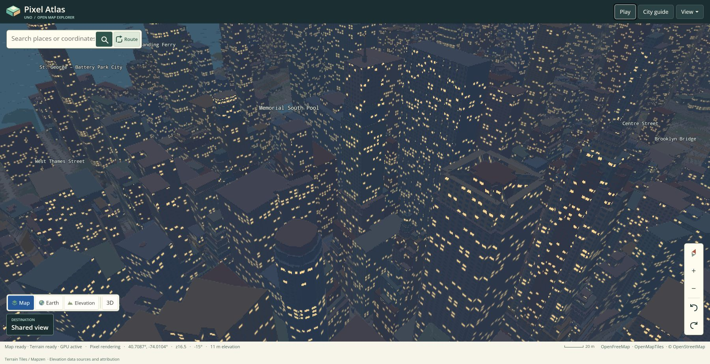

# Browser release identity

The browser publish pipeline versions its bootstrap package from the finalized deployment contents. This makes C#, native WebAssembly, packaged assets and browser-adapter changes select new resource URLs when a release is published.

## Why the extra publish step is needed

The installed Uno.Wasm.Bootstrap 10.0.98 computes its package-folder hash before generating `uno-config.js`. The static assets can therefore retain the same package path while the generated configuration selects a different fingerprinted .NET loader. The ordering is visible in the pinned SDK's [ShellTask implementation](https://github.com/unoplatform/Uno.Wasm.Bootstrap/blob/5b87c821e575a61f1ea12826f03a80fef1c1f27f/src/Uno.Wasm.Bootstrap/ShellTask.cs).

This occurred during verification of the camera/rendering release: the preceding deployment and the new artifact both used `package_b15685d25e9696411d12c8dce8322288e85f8f1b`, and the connected browser continued executing the old native bundle after an ordinary reload. A matching bootstrap-folder name was insufficient to establish which C# release was running. PWA support was disabled in these artifacts.

The project-owned fix is in [VersionWasmPackage.targets](../build/VersionWasmPackage.targets) and [VersionWasmPackage.cs](../build/VersionWasmPackage.cs), introduced by [1829855](https://github.com/wieslawsoltes/UnoPixelMap/commit/1829855ea07d1fd43b66d4478210398a605bb3c9).

## Publish sequence

The app imports `Uno.Sdk` props and targets explicitly, then imports the project finalizer last. Its `AfterTargets="Publish"` callback follows Uno's nested AOT publish, configuration update, WebGL/worker fixups and the SDK's other publish callbacks. Inner and cross-targeting publishes skip it.

The finalizer resolves the active package from the generated index and computes a SHA-256 identity over sorted logical files: the finalized `_framework` contents, active package assets and configuration, generated index and service worker, and the two root browser adapters. File paths and content hashes are length-prefixed. Its package references and adapter-version parameters are normalized so the result is independent of the current package name and output directory. Compressed transport representations are excluded from identity inputs.

The resulting `package_<64 hex digits>` name appears in the generated package references. The index also receives a matching `pixelmap-build` query parameter for `audio/journey-audio.js` and `input/map-input.js`.

## Output and failure handling

Framework files are read without being rewritten; their SDK filenames and integrity hashes remain valid. Rewritten generated text loses its obsolete `.gz` and `.br` siblings. When reusing an existing matching package, its logical files must agree, and compressed representations are refreshed from the current SDK output.

The task stages the complete package and root entry-point changes before committing them. Read-only entry points and conflicting destination contents fail before mutation. Root replacements and their compressed siblings have backups for rollback. The former active generated package is retired only after successful commit; unrelated stale package directories remain untouched. If rollback itself cannot finish, the build fails and reports the location of the retained recovery files.

Publishing requires the installed .NET SDK and its Roslyn task factory. The finalizer has no Node or Python runtime dependency.

## Verification

The focused regression uses Node's standard library to invoke the production MSBuild task:

```sh
node tests/packaging/package-identity.cjs
```

It covers deterministic identities, repeated finalization, repeated SDK publishing into the same directory, runtime/adapter/asset changes, rewritten references, real gzip/Brotli reuse, missing-loader and destination conflicts, and read-only failure followed by a successful retry.

The Pages workflow verifies the already finalized output after ordinary publishing:

```sh
dotnet publish src/PixelMap.App -c Release -f net10.0-browserwasm -o artifacts/atlas
node tests/packaging/package-identity.cjs artifacts/atlas/wwwroot
```

The artifact verifier first requires the 64-digit package identity and both adapter version parameters. It snapshots the entire artifact, runs the task twice, and requires both passes to preserve every path and byte. It then verifies the loader's boot-resource hashes and decompresses the remaining gzip/Brotli files for comparison with their logical content. A skipped or incorrectly ordered publish hook therefore fails verification.

Applying the finalizer to the exact rendering artifact from run `42291311815` produced `package_0c8dc2c18e3de69f54efa23b7bc3750b1cc94303e46edc0827e7e6ded4a8aff6`. All 72 boot-resource hashes and all 219 framework files, including compressed variants, were preserved. All 250 remaining compressed representations decoded to their corresponding logical files, and both verification passes were byte-for-byte no-ops. These are packaging checks against that exact artifact; the paired rendering measurements remain documented separately in [performance.md](performance.md).

## Initial cache-identity release

The full Release build at `1829855ea07d1fd43b66d4478210398a605bb3c9` passed native tests, strict artifact verification, the complete Chromium suite and Pages deployment in [run 42300149918](https://github.com/wieslawsoltes/UnoPixelMap/actions/runs/42300149918). Deployment completed at 2026-11-06 22:15:27 UTC. Chromium also compared six direct-versus-transfer presentation cases with zero differing pixels and passed the camera, terrain, delayed-picking, input and play-mode checks.

The resulting Pages artifact `13543114803` is 88,312,197 bytes, with ZIP SHA-256 `7ccce72bc8c2ae046377824d8606b977a533ea325da7978ee8e41a3b9a28c58d`. Its finalized package is `package_871fef5afae1a5f565f462a2d74e160943500c4634bafad60c6a56a2a23455bd`, and its loader is `dotnet.e266ijwea0.js`. The native WASM SHA-256 is `97dd179318ebe0bdfc5ac0ed4427f47182ed1773f476dce30fbb08f192b52f95`. The strict CI verifier confirmed all 72 boot-resource hashes, all 250 compressed representations and two complete no-op finalization passes before uploading this artifact.

The deployed site was also checked in the connected browser on 2026-11-06. The DOM referenced this exact finalized package and both matching adapter version parameters. Starting a first-person walking session in Lower Manhattan at the 1800-pixel-wide viewport, with terrain enabled, reached **Map ready · Terrain ready · GPU active** after all requested tiles loaded. The console contained the direct Skia WebGL presentation message from `dotnet.native.nz766qomp0.js` and no geometry-cache exception. The session was paused before capturing the [live verification screenshot](verification/1829855-manhattan-gpu.jpg). This verifies the previously reproduced dense-city fallback scenario on the deployed release; it is not a browser performance measurement.

## 7 November rendering artifact

The Release artifact for `9171e95efab06db930a97dde212d754b8da48f60` comes from [run 42370846132](https://github.com/wieslawsoltes/UnoPixelMap/actions/runs/42370846132). Its `github-pages` artifact is `13574430917`, with **88,296,669 bytes** and ZIP SHA-256 `2d75cd54800e363c496c1548c22b53c4611c14d9a3633dbeb80c13878cbaae73`. The source includes the bounded depth index, pixel-window filter, North Up alignment fix and current journey-draft submission.

| Resource | Identity |
| --- | --- |
| Finalized package | `package_a0ae44c1d7a17c40e475a043b19e258b0e2701134e71946f2c140b5b4093f6d9` |
| Index SHA-256 | `0340cba99bdf6fdc2f58c96622feef3cd3e32e25d01da25d572d3d235fade482` |
| Loader | `dotnet.9a2r0bvpc9.js` |
| Loader SHA-256 | `5180ff773f69c6b957827d123d9e984355af1054fe31f558dd2cc3de8f6462df` |
| Native JavaScript | `dotnet.native.tmo31e415o.js` |
| Native JavaScript SHA-256 | `8b473fd368e98adf895746e5131968b6d461fe6aa5823d67037ec7ecc1194bc6` |
| Native WASM | `dotnet.native.r40ls9zxle.wasm`, 65,940,113 bytes |
| Native WASM SHA-256 | `153cd183a5572ea9be22944ab059a586d75c7b45a1fa272f21abbe5df96d43c7` |

Both root adapters use the finalized package digest as their `pixelmap-build` parameter. The native JavaScript file is shared with the preceding acceptance attempts; its filename alone does not identify this release. The strict build checks verify 72 boot-resource hashes, 250 compressed representations and two byte-preserving finalizer passes. An independent extraction agrees with the archive, index and runtime hashes above.

The run passed native tests, the complete Chromium suite and Pages deployment, which completed at 2026-11-07 12:30:22.8567933 UTC. The independent live replay then failed with a native Skia allocation abort at 12:36:14.277 UTC. Consequently, the successful CI and deployment are not final live acceptance. The [failure record](verification/live-native-raster-failure-9171e95.json) pins this package and WASM, preserves the symbolicated native stack, and explicitly identifies the subsequent frozen image as an aborted application state. Investigation uses the exact archived application bytes on an isolated diagnostic branch; that branch does not build or deploy an application.

The paired browser measurements remain attached to the exact `668bf4b` artifact. Its complete application `src` tree, `be18099689edbe6a951b9e604691adb28af13365`, also identifies the source above: the intervening changes correct the browser regression's ComboBox selection assertion. This source equivalence is not a claim that the two compiled artifacts are byte-identical. [Measurements and separate acceptance provenance](verification/browser-rendering-668bf4b-provenance.json)

## Compact-mesh rendering artifact

The compact building-mesh source `c937ddd192619f48c1a2ec682845b52bc1eebff8` is built by [run 42377138938](https://github.com/wieslawsoltes/UnoPixelMap/actions/runs/42377138938). Its successful `browser` build job is `128416964285`. The `github-pages` artifact `13576502635` contains **88,286,013 bytes**, with ZIP SHA-256 `ba0b8ae7a050c64bd7459ef6fa30e5db9c2901b102d843171d3b4bfd1e7c57cb`; its extracted `artifact.tar` has SHA-256 `256e08a34dcc6e1022c7441ebd2cf588cc4d5074091bc3070372594dc31713e7`.

| Resource | Identity |
| --- | --- |
| Finalized package | `package_a319a6ccf9e1718d6a1abc14d362e7625d4a191633147981653b6bcc9d604825` |
| Index SHA-256 | `69f7ba97caaa9d55b268b2d573b5355c337cf07a9673b1e79c8c15812a370d68` |
| Loader | `dotnet.3bwjsd43eu.js` |
| Loader SHA-256 | `4f1a73ec0925cf906e9a1a2b09546b39cc2b59844257c2d46fb6632a7afe2685` |
| Native JavaScript | `dotnet.native.55qcjjnjf2.js` |
| Native JavaScript SHA-256 | `595e0a9c7fd699394ab24c87fc152cb482b59ea4a65ac1e17877d68a0e2f95fa` |
| Native WASM | `dotnet.native.3l7hksc7hn.wasm`, 65,940,623 bytes |
| Native WASM SHA-256 | `a7441c8610c1aa6c76fd92fb1b8ac5fc92889b37933f19d6d93b90bfcb4f1912` |

All 72 boot resources, the index, bootstrap, configuration and both versioned browser adapters were independently rehashed against the extracted archive. The runtime remains `InterpreterAndAOT`. Browser-suite completion, paired performance measurements, Pages deployment and independent live acceptance are tracked separately from this successful artifact-build gate.

The complete run finished successfully: native/GLES and packaging checks, the Chromium suite, the paired performance job and Pages deployment all passed. Deployment reported success at **2026-11-07 13:53:16.4088026 UTC**. The bundled-data browser suite includes nine acknowledged DPR-2 close-camera checkpoints and immediate journey submission with both CPU and GPU rendering. [Exact CI jobs, artifacts and traces](verification/browser-validation-c937ddd.json)

The connected browser then loaded the package above at 1800 × 924 CSS pixels, DPR 2, using detailed live Manhattan data. Starting a North Up walker with Night and terrain relief, applying the original native +480/−240 scroll requests, checking the Orbit picker, and acknowledging pause/resume twice and exit completed without a captured managed exception or native abort. Exit restored the ready GPU overview. A bounded DOM inspection timed out during the first pause step; subsequent state and control acknowledgements are recorded explicitly. This finite functional check does not measure allocator free space or establish performance on all hardware. [Complete live evidence](verification/live-rendering-c937ddd.json)



The [frozen-corpus memory comparison](verification/corpus-memory-comparison-c937ddd.json) separately measures the original and compact artifacts against the same captured response bodies and three camera cycles. The [paired browser performance record](verification/browser-rendering-c937ddd-provenance.json) compares this exact candidate artifact with pinned baseline run `42300149918`; its mixed timing results are retained in [performance.md](performance.md#current-paired-browser-measurements).

## Pinning performance baselines

A push that runs the Pages workflow can request a paired play benchmark and pin
its baseline in the commit message:

```text
[play-benchmark] [play-baseline:42300149918]
```

The run ID must identify a successful `main` run of the same workflow in the
same repository, with exactly one unexpired `github-pages` artifact. The
candidate is always the current run's exact artifact. Before downloading, the
workflow validates the run and artifact metadata, including matching source
SHAs, and records each archive's SHA-256 digest. After downloading and extracting
the applications, it verifies the boot-resource hashes and package references.
It fails if the requested baseline is unavailable.

Manual dispatch retains the `play_benchmark` and `baseline_run_id` inputs. If no
baseline is specified, selection uses the latest other successful `main`
run. Malformed, repeated or conflicting commit markers and workflow inputs
fail validation. Commit messages enter the parser through an environment
variable and are treated as data, never shell or Python source.

The evidence records whether the baseline came from an input, a commit marker
or automatic selection, together with the requested and resolved run IDs.
Moving scenarios run baseline → candidate → candidate → baseline, in fresh
browser processes. Pages artifacts are retained for seven days and paired
performance artifacts for 30 days; checked-in CSVs and provenance preserve the
reported measurements after artifact expiry. See [current results and their
scope](performance.md).
