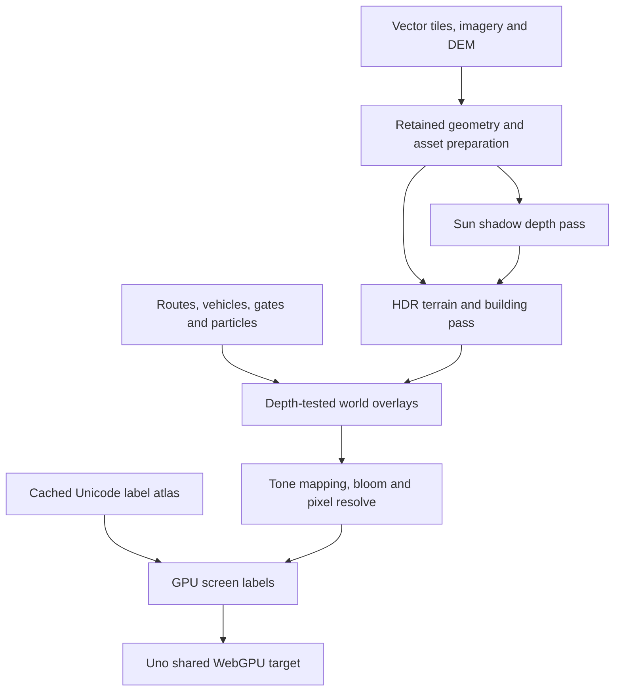

# Uno Platform 7 and native WebGPU migration

## Status and scope

This branch migrates Pixel Atlas from Uno.Sdk 6.7.30 to Uno.Sdk 7.0.5 and replaces
every production map presentation path with Uno's shared-device
`WebGpuCanvasElement`. The Uno UI also uses the WebGPU graphics provider.

The production renderer passes the full native regression suite and all 31
published-browser scenarios in both Debug and Release AOT. The final source
revision is `dad16fcd65f8ceb67e43eed95c4af0ef9787609f`, verified by
[run 15](https://github.com/wieslawsoltes/UnoPixelMap/actions/runs/43128831943).
Selected original screenshots, both scenario reports, GPU traces and file hashes
are preserved in the [browser verification record](verification/uno7-webgpu-dad16fc/README.md).
The quality target is a modern real-time 3D renderer. Implemented
graphics features do not by themselves establish commercial AAA visual quality,
hardware frame rates, or a measured improvement over the previous release.

## Verified dependency graph

| Dependency | Previous | Migration |
| --- | --- | --- |
| Uno.Sdk | 6.7.30 | 7.0.5 |
| Uno core / graphics | 6.7.135 GL add-in | 7.0.32 core, Composition.WebGpu and Graphics3DWebGpu |
| .NET SDK used for verification | 10.0.403 | 10.0.403 |
| Target frameworks | net10.0 / net10.0-browserwasm | unchanged |
| Browser bootstrap | driven by Uno 6 SDK | 10.1.1 from Uno 7 SDK |
| SkiaSharp asset processing | 3.119.2 | 4.151.1, managed and native aligned |
| Silk rendering API | OpenGL 2.16.0 | WebGPU 2.23.0 |
| GL reference tests | production renderer | test-only OpenGL 2.23.0 dependency |

Uno 7 removes the old native rendering hosts. All Uno-dependent projects are
rebuilt against the new SDK. No Uno 6 graphics package or Silk.NET.OpenGL
dependency remains in the production graph.

Authoritative upstream references:

- [Uno 7 migration guide](https://platform.uno/docs/articles/migrating-to-uno-7.html).
- [WebGPU rendering backend](https://platform.uno/docs/articles/features/using-webgpu-rendering.html).
- [WebGpuCanvasElement](https://platform.uno/docs/articles/controls/WebGpuCanvasElement.html).
- [Uno.Sdk 7.0.5](https://www.nuget.org/packages/Uno.Sdk/7.0.5).
- [Released canvas source](https://github.com/unoplatform/uno/blob/7.0.32/src/AddIns/Uno.WinUI.Graphics3DWebGpu/WebGpuCanvasElement.cs).
- [Released browser device initialization](https://github.com/unoplatform/uno/blob/7.0.32/src/Uno.UI.Composition.WebGpu/ts/Runtime/WebGpuInit.ts).

Uno explicitly describes its WebGPU backend as experimental. This migration uses
published APIs and pinned releases, rather than private host reflection.

Bootstrap 10.1.1 moves `uno-config.js` beside `index.html` at the publish root.
The deployment finalizer follows the selected bootstrapper's config import,
checks its package identity, and includes the root configuration in transactional
hashing and rewrites. The packaging gate still verifies loader integrity,
compressed representations and byte-preserving repeated finalization. Its
root-layout, incremental-publish, rollback and retry fixtures pass. See
[publishing details](publishing.md).

## Host and control migration

The application and control library declare `Skia;WebGpu`. SkiaSharp remains
necessary for CPU image decoding, cached map artwork and glyph-atlas generation.
The host registers **only** `WebGpuBackend.CreateGraphicsProvider()`. There is
no Skia UI provider or CPU/GL map fallback selected at runtime.

The previous implementation depended on private Uno 6 browser renderer types,
native GL resolver interception, and either same-context Skia texture adoption
or a separate GL canvas followed by framebuffer transfer. The migration removes:

- `GpuTerrainSurface.cs` and its alternative presentation paths.
- `BrowserGpuContext.cs`, `BrowserGpuSurface.cs` and `BrowserGpuReadback.cs`.
- `pixel_map_gl_readback.c`, the native compile item and resolver linker flag.
- The `GLCanvas` feature and old Graphics3DGL add-in reference.
- Production compilation of `GlMapRenderer.cs` and `GlMapShaders.cs`; these
  files are linked into the test assembly as historical regression references.

`PixelMapControl.MapSurface` now derives from `WebGpuCanvasElement`.
`WebGpuMapRenderer` receives Uno's `context.Api`, borrowed device and queue.
It renders into the supplied texture view. No second browser graphics context,
texture-to-CPU copy, image upload for final presentation, or full-frame CPU
overlay bitmap participates in the production path.

`MapSurfaceViewport` keeps logical layout and input coordinates separate from
native texture dimensions. Uno 7.0.32 records a visual into a fresh local drawing
session, then applies display density when replaying it. The canvas's target-size
calculation therefore misses the root density in that recording path. A public
`Canvas` host arranges the WebGPU element at the requested physical dimensions and
applies an inverse `ScaleTransform`; `XamlRoot.RasterizationScale` and its `Changed`
event keep it synchronized. Camera preparation, picking and the marker remain in
logical coordinates, and the existing glyph-density calculation uses the actual
native target. No private reflection or alternate graphics context is involved.
See the pinned [visual recording path](https://github.com/unoplatform/uno/blob/7.0.32/src/Uno.UI.Composition/Composition/Visual.skia.cs)
and [canvas target sizing](https://github.com/unoplatform/uno/blob/7.0.32/src/AddIns/Uno.WinUI.Graphics3DWebGpu/WebGpuCanvasElement.cs).

The host clips the expanded child to its logical viewport and bounds the
presentation texture at 8,388,608 pixels (32 MiB of color) and 8192 pixels per
dimension. Very large requested targets scale down proportionally. This borrowed
Uno texture is separate from the renderer's own scene/shadow budgets. A zero-sized
viewport clears its child size and clip; loading, unloading and display-density
changes attach and detach only the public root event.

The public `IsGpuRenderingEnabled` switch was removed. Its replacement is
`RenderingQuality` with `Balanced`, `High` and `Ultra` values.
`IsGpuRenderingActive` remains a read-only status indicator. The View menu
exposes the three quality choices and the four existing rendering styles.

## Render pipeline

### Geometry, precision and depth

Terrain uses retained height/artwork texture arrays, instanced patch data, and
shared grid or block index buffers. Buildings retain 32-byte vertices and model
storage buffers. The scene uses camera-relative transforms to avoid geographic
coordinate precision loss. Perspective clipping and depth mapping follow the
existing camera and terrain conventions.

A `GpuMapFrame` owns immutable geometry/source references. Controls advance
the displayed frame and the interaction/picking state together. A failed GPU
submission invalidates interaction queries instead of exposing geometry that
was prepared but never displayed. Existing sparse
CPU depth queries remain available for label visibility, picking and terrain
interaction without reading a GPU depth buffer back to the CPU.

Each frame uses a 512-byte aligned uniform slot; building draws select their
slot through a dynamic offset. Terrain instances occupy 80 bytes.
Resource limits come from the actual shared device. Unsupported limits result
in an explicit diagnostic instead of an invalid draw.

### Lighting and image quality

Normal and Roblox styles implement:

- Cascaded directional sun shadows with 3 × 3 percentage-closer filtering.
- GGX-based material lighting and sky illumination.
- A linear-light RGBA16F scene target.
- Height-dependent atmospheric fog.
- ACES-fit tone mapping and a small bright-pass bloom resolve.
- Quality-dependent multisampling and edge antialiasing.
- Correct final encoding for linear and sRGB target formats.

Roblox vertical terrain faces use explicit outward world-space normals; their
zero vertical component cannot orient a derivative normal reliably. Top and
bevel faces retain their geometric normals.

High uses two sun cascades and Ultra uses four; Balanced retains one. Each
cascade fits a slice of the camera's visible depth range, with finer coverage
near a physical walking camera. Separate depth-array layers retain the same
512-byte per-draw uniform contract: four affine projections occupy twelve
four-component rows, with homogeneous W fixed at one. Fixed shadow vertex entry
points select each matrix without overwriting uniforms between encoded passes. Overlapping slices
blend across the final 10% of each interval, and bias follows each layer's
physical texel size. Terrain and building geometry supply the shadow casters.
Vehicle and route overlays use scene depth; they do not currently cast or
receive the full physical-lighting shadow treatment.

Receiver radii and light-grid snapping use double-precision Mercator coordinates
before conversion to local physical metres. Quantizing directly in physical
metres while scaling a global Mercator anchor by latitude caused fractional-texel
drift during north–south pans. The corrected grid preserves its angular spacing
until the fitted radius crosses a quantization boundary; filtering has a padded
border and the previous snapping-translation sign is corrected.

The renderer retains a separate complete building index stream for sun casters,
so camera-frustum culling does not erase shadows from loaded offscreen buildings.
An unchanged immutable frame and quality preset reuse the previous shadow map.
The same frame also retains terrain instances, building uniforms and draw
selection while route or vehicle overlays animate. Physical/raster dimensions,
quality and shadow-size changes invalidate this scene state. Residency age
advances with scene preparation, so animated overlays cannot evict buffers they
still use. Reuse is committed after queue submission and invalidated on failure.

Pixel and Minecraft retain their logical pixel grid, palette treatment, window
details and nearest-neighbor resolve. Their prior baked ground-shadow appearance
is retained. Smooth styles disable the old baked shadow so it is not doubled
with the new sun pass. Primitive-edge and color-rounding differences from the
GL renderer are possible; full-frame bit identity has not been claimed.

| Quality | Smooth geometry samples | Sun depth layers | Shadow storage | Requested scene-pixel cap | Bloom |
| --- | --- | --- | --- | --- | --- |
| Balanced | 1 | 1 × 1024 × 1024 | 4 MiB | 2,073,600 | off |
| High (default) | 4 | 2 × 1536 × 1536 | 18 MiB | 3,686,400 | enabled |
| Ultra | 4 | 4 × 2048 × 2048 | 64 MiB | 8,294,400 | enabled |

The actual smooth resolution is constrained by both the pixel cap and a
256 MiB attachment budget. Ultra may therefore render below its requested pixel
cap, particularly with multisampling. Physical display density is included;
logical projection coordinates remain unchanged. Pixel styles preserve the
logical grid; Balanced alone may increase their moving pixel size under CPU
submission pressure.

Shadow storage is bounded separately at 64 MiB and included in nominal resident
bytes. It is not included in the scene attachment budget. Each changed scene
submits one shadow geometry pass per cascade; unchanged scenes reuse all layers.
The additional High/Ultra depth work buys finer nearby shadows rather than a
measured frame-rate improvement. Pixel styles bind only a 1 × 1 placeholder.

### Native scene overlays

`WebGpuSceneOverlay` produces 48-byte vertices and indexed triangle streams for
three batches: ordinary depth-tested world geometry, occluded navigation
silhouettes, and full-resolution labels after tone mapping.

Routes retain provider-distance progress, terrain draping, wrapped world copies,
antimeridian handling, stop flags and checkpoint gates. Walking, bicycle, car,
boat, train and aircraft models retain physical and miniature representations.
World effects use a fixed 56-particle buffer and preserve pause, seek, teleport,
resume and continuity behavior.

An unchanged stationary standalone vehicle advances its simulation timestamp
without rebuilding geometry or submitting an identical frame. Routes and gates
retain their animation updates. Orthographic route depth bias is clamped to the
WebGPU clip interval so annotations raised above the terrain remain visible.

Labels reuse the existing Unicode placement, ordering, collision and occlusion
rules. A bounded 2048 × 2048 atlas caches font assets; only changed atlas regions
are uploaded. Labels are GPU quads, not a rasterized viewport overlay.
Label buffers have a separate revision and remain resident across vehicle-only
updates. Retained-frame reactivation restores the matching camera and label
sources, including an A → B → A → B sequence.
Smooth styles rasterize glyph assets at the physical display density, quantized
in quarter steps and bounded to 3×. Logical text metrics and collision boxes stay
unchanged. Pixel and Minecraft keep their original 1× glyph artwork. Segmented
long names include populated filtering guards to prevent atlas-boundary seams.
`PrepareGpuFrame(..., prepareLegacyOverlay: false)` avoids recording the old
Skia label display list. The default parameter remains true for regression
callers that exercise the historical renderer.

## Retention, ownership and failure handling

The map does not release Uno's API, device, queue, target texture or target view.
It owns and releases its own GPU buffers, views, textures, samplers, bind groups,
pipeline layouts, pipelines, shader modules, encoders and command buffers.
Owned buffers and textures are explicitly destroyed before their native handles
are released; reclamation does not depend on JavaScript garbage collection.
Previously submitted work retains the resource lifetime guaranteed by WebGPU.

The target is valid only during `RenderOverride`. Resize recreates the
extent-dependent attachments. Unload releases scene resources and GPU resources
through the canvas lifecycle. Partial initialization cleans up explicitly because
Uno does not invoke `OnDestroy` when a derived `Init` throws.

Retained mesh storage is bounded to 128 MiB. Intermediate attachments are bounded
separately to 256 MiB. Tile arrays, atlas storage, uniforms, pipelines and driver
allocations are additional. `ResidentBytes` is a bounded-resource estimate, not
total process or GPU-driver memory; `AttachmentBytes` is reported separately.
The resident estimate includes the glyph atlas, retained overlay buffer capacity,
uniforms, shared indices and material textures. Driver layout, padding and
pipeline storage are not measurable from those nominal allocation sizes.

Unavailable WebGPU, absent adapters, startup exceptions, uncaptured GPU errors
and device loss show an accessible HTML recovery panel with a reload action.
This panel does not depend on the failed GPU device. The canvas obtains the
actual shared browser device through Uno's public `WebGpuJsInterop.GetJsObject`
API and observes that device's loss/error events. A managed callback stops map
submissions, clears the displayed scene used by picking, and reports failure to
the UI. No global device-creation hook or additional device is needed.
The device and its existing JavaScript proxy remain borrowed. Each canvas owns
only its subscription token; unload, initialization failure and teardown detach
the callback and error listener. One pending loss continuation per device avoids
accumulation across reloads, and a generation guard rejects stale notifications.
The HTML panel remains available if managed error reporting itself fails.
The observer lives in the reusable control's existing `map-input.js` asset.
Embedding hosts do not need the sample application's HTML or globals; an
optional `PixelAtlasGraphics.fail(message)` hook supplies custom recovery UI.

## Verification and evidence

### Final migration verification

| Gate | Result on `dad16fc` |
| --- | --- |
| Native data, rendering, GLES references, routing, simulation, input and audio | Passed |
| Independent WebGPU presentation and opaque-pixel checks | Passed |
| Debug interpreted publish and package identity | Passed |
| Debug browser scenarios | 31 passed, no report errors or failures |
| Release AOT publish and package identity | Passed |
| Release AOT browser scenarios | 31 passed, no report errors or failures |

The actual CI checkout is PR merge `78fdef7f0a1ef1147a960760eb7c9f4f0cf4dabd`
against base `c6a26075b5767e2aa82e87e949194e82c0e9cb1e`. The final documentation
commit adds the original evidence without changing the tested application,
shaders or harness. The [evidence manifest](verification/uno7-webgpu-dad16fc/manifest.json)
records source/build identities and SHA-256 hashes; the [verification page](verification/uno7-webgpu-dad16fc/README.md)
includes the actual Release screenshots and explains their scope.

Both browser builds pass the initial and post-pinch Normal density checks:
390 × 736 logical pixels map to a 780 × 1472 native target and scene at DPR 2.
Pinch changes map zoom while page scale and UI layout remain fixed. All six
journey modes reach an intermediate position and remain exactly paused through
queue completion and capture. Destroying Uno's actual shared device reports a
managed failure and leaves the map-submission count unchanged afterward.
Desktop/mobile GPU records contain no unexpected errors, losses, map texture
readbacks or WebGL contexts. The Ultra shadow probe verifies submitted geometry
in each of the four depth-array layers.

Independent visual review confirms native-density label/facade detail and the
finer Ultra facade shadow at the same paused camera position. Still images do
not establish temporal stability or hardware frame rates. Both configurations
use full Chromium under Xvfb with the Google SwiftShader software adapter.

### Native checks and earlier integration results

The restored package graph matches the versions above. Rendering-library Release
compilation succeeded. The full native regression job also passed on GitHub for
[fee37c5](https://github.com/wieslawsoltes/UnoPixelMap/commit/fee37c54d188f49cedd50494b51ac3588b67750c):
[workflow run](https://github.com/wieslawsoltes/UnoPixelMap/actions/runs/43107888651).
The browser application also completed managed compilation, native linking and
AOT compilation before reaching a custom publish-versioning layout mismatch.

That job includes data, elevation, imagery, routing, simulation, input and audio
checks; the complete CPU rendering corpus; and the retained GLES reference
renderer. Selected corpus sizes include 11,935,261 sparse/eager depth queries,
9,063,600 projected depth comparisons, 1,122 physical-camera building-cache
poses, 24 exact label fixtures and 16 real Manhattan label views. These validate
preserved geometry/interaction behavior and the reference renderer, not the new
WebGPU scene's entire raster output.

The new `--webgpu-overlay` checks passed locally: Unicode atlas/halo composition,
all six vehicle modes across four styles, route and gate geometry, antimeridian
and near-plane clipping, finite vertices, valid indices, atlas reuse, particle
capacity and lifecycle. Follow-up checks covering retained-frame reactivation,
independent label revisions, empty label sets, orthographic route depth and idle
timestamp advancement passed locally and in the current native CI job.
The high-DPI follow-up also passed exact 1×, 2× and 3× comparisons against direct
scaled text, including a segmented Unicode name, density-only invalidation,
bucket reuse, the atlas density cap and unchanged pixel-style glyph density.
The scene-retention guard covers 240 changing overlays, retry after failed
preparation and eviction after 181 distinct scene preparations. This validates
the managed retention policy; it does not measure GPU completion time.

The browser observer lifecycle regression exercises 100 reloads with one pending
loss continuation, exact-device notification, shared subscriptions, deterministic
callback/listener release, stale and unrelated devices, cancellation of queued
loss notifications, partial attachment failure and HTML diagnostics during
managed teardown. It validates the observer protocol; the real browser suite
separately destroys Uno's actual shared device and checks that map work stops.

The cascade geometry checks pass 400 physical/map, perspective/orthographic,
desktop/handset and Day/Dusk fits, including overlap coverage, complete offscreen
caster heights, signed/exaggerated altitude and artwork-unit independence. North
and south motion at positive/negative mid-latitudes and 80° reduces the worst
tested fixed-point phase residual from 0.319214 to 0.000122 shadow texel. For the
street-camera fixture, near-layer spacing is 0.0286 m at High and 0.0215 m at
Ultra, compared with 0.1562 m for the prior single-map fit. These are projection
measurements, not measured image quality or hardware throughput.

The four-layer refinement adds 27,542 High-to-Ultra comparisons, including exact
split/blend boundaries and their adjacent floating-point depths. Both the
selected layer and every contributing cross-fade layer retain at least High's
sampling density within the tested shared range. At the 49 m facade fixture,
High's far layer supplies 1.1003 m per texel and Ultra supplies 0.0521 m. Separate
checks compare packed three-row affine projections with the original homogeneous
matrices for receivers and casters, and preserve unrelated uniform fields.

The six exact production WGSL modules, 28 pipeline variants and 28 encoded
passes pass native Dawn validation on its Null backend. This validates shader
semantics and binding/command contracts; the Null backend does not execute a
graphics driver or produce rendering evidence.

[Run 11](https://github.com/wieslawsoltes/UnoPixelMap/actions/runs/43117004105)
on `423e279` passed the independent presentation test and the desktop scenario
in both Debug and Release AOT: initial city and camera movement, all four styles, all three
quality presets, imagery, relief, elevation, free-roam movement and resize.
The images contain the actual 3D city and Uno UI. Fenced Debug GPU evidence records
607 map draws, 40 map submissions, depth-writing and 4× multisampled pipelines,
zero map texture readbacks, zero WebGL contexts and no GPU errors or losses.
The complete suite then stopped in the first journey when its short preview
finished before the pause action. This desktop result does not establish the
remaining journey, mobile and device-loss scenarios; their latest outcome is
recorded in the PR.

[Run 12](https://github.com/wieslawsoltes/UnoPixelMap/actions/runs/43119733973)
on `0b9c737` again passed native regression, presentation, both publishes and
package checks, and desktop rendering. Debug also passed Drive and Bike before
Walk stalled on Pause's disabled accessibility state while the preview was still
moving. The application now publishes actual enabled-state transitions through
the public `RaisePropertyChangedEvent` API, followed by peer invalidation. This
handles the automatic peer cache retaining its initial enabled value when the
browser accessibility tree is created after a control has already been disabled.
See Uno 7.0.32's
[automatic property cache](https://github.com/unoplatform/uno/blob/7.0.32/src/Uno.UI/UI/Xaml/Automation/Peers/AutomationPeer.mux.cs)
and [browser property routing](https://github.com/unoplatform/uno/blob/7.0.32/src/Uno.UI.Runtime.WebAssembly.Browser/Accessibility/WebAssemblyAccessibility.cs).
The browser check also uses the public 0.25× playback option and checks the
enabled semantic state after pausing. Independent suites and all six route modes
retain their failures and continue, with a failing overall exit if any case fails.

[Run 13](https://github.com/wieslawsoltes/UnoPixelMap/actions/runs/43123975745)
on `a2b1351` passed native regression, independent presentation and all 30 browser
scenarios in both Debug and Release AOT. Every journey paused at an intermediate
position and retained exactly that progress through capture. Destroying the real
shared device reported a managed failure and kept map submissions at 4 → 4.
Release desktop evidence records 741 draws, 41 map submissions and zero GPU
errors, unexpected losses, readbacks or WebGL contexts.

Visual review found that the DPR-2 screenshot contained a 1× map texture even
though the surrounding Uno UI used native pixels. The viewport fix above and the
new 31-scenario gate explicitly require native target/scene dimensions at DPR 2,
including an initial Normal view with a visible map label. Review also identified
a nearby facade where Ultra's middle cascade had a visible stepped shadow edge.
Its measured receiver range is approximately 38–60 m. Ultra now preserves High's
24 m near interval, adds 64 m and 256 m coverage, and extends to 2400 m at street
level. This targets that facade without reducing near sampling or jumping from
the second slice directly to the far map. The updated native checks pass;
the following browser run verifies the actual visual result.

[Run 14](https://github.com/wieslawsoltes/UnoPixelMap/actions/runs/43127009651)
on `02d5e63` passes the full native regression and independent presentation gates.
Its Debug and Release AOT browser evidence confirms the corrected native density: a 390 × 736
logical map uses a 780 × 1472 target and scene inside the 780 × 1688 DPR-2
screenshot. The initial Normal view includes a visibly sharp Financial District
label, aligned map geometry and native-density Uno controls. The four-layer Ultra
street capture has a finer facade shadow than the earlier three-layer fit; each
High/Ultra pair uses the same paused camera within its run. Across runs, the
movement-driven camera can stop at a different position, so those images are not
a pixel-identical before/after benchmark.

The new mobile scenario then used the incorrect accessible name `Pixel rendering`
when returning to the existing `Pixel art rendering` menu item. That locator
timeout fails both complete browser results despite the passed initial density
assertions and other suites. The test now uses the exact existing UI label,
matching the desktop style checks. Run 15 passes pinch and the final Normal
density capture in both configurations with the original assertions retained.

The flight demo's unavailable external map data leaves uniform ground near its
airport origin in the offline fixture. Its screenshot establishes route/aircraft
overlay and playback behavior, not detailed airport terrain quality.

### Validation investigations

The first native complete-frame fixture aborted in SwiftShader after submission.
A sky-only variant also aborted, while independent clear and constant-triangle
fixtures succeeded. No complete-frame native screenshot or timing is established
by that run. Local Chromium cannot start because this execution environment
denies its required process sockets. Published browser CI is the authoritative
integration gate.

[Run 7](https://github.com/wieslawsoltes/UnoPixelMap/actions/runs/43110751306)
on `998bdaf` successfully published both the interpreted application and the full
Release AOT application and passed their strict package-identity checks.
Chromium then reported a lost graphics device
with `A valid external Instance reference no longer exists.` before a usable
scene screenshot was captured. Its frame counters establish submission only;
the captured recovery panel is not accepted rendering evidence. The application
and Uno source audits found balanced instance/device ownership. The next browser
configuration tests full Chromium with the software-GPU watchdog disabled and
bounded completion timeouts, while retaining every device-loss failure.

[Run 8](https://github.com/wieslawsoltes/UnoPixelMap/actions/runs/43112585477)
captured the earlier failure more precisely: Chromium could not create the
shared image backing its application canvas, followed by device loss. It used
one GPU device and reported no map readback or WebGL contexts. CI now aligns
ANGLE, Vulkan presentation and Dawn with the
[Vulkan SwiftShader configuration from Chromium 156's own pixel tests](https://github.com/chromium/chromium/blob/156.0.8078.4/content/test/gpu/gpu_tests/pixel_test_pages.py).
Adapter identities and explicit device-destruction stacks are retained in the
evidence; no device-loss or shader errors are filtered out.

[Run 9](https://github.com/wieslawsoltes/UnoPixelMap/actions/runs/43114129603)
published both Debug and Release applications and passed package verification. Its
aligned software adapter reported no device loss or GPU error, but the whole
application screenshot was transparent, including the Uno toolbar. Its native
map commands had been submitted; GPU completion had not yet been checked before
capture. The next test revision jointly bounds shader queries and queue fences
before screenshots, preserves Chromium's screenshot feature when enabling
Vulkan, and separately verifies a small WebGPU canvas before building the app.
Transparent captures are rejected and do not establish rendering correctness.

[Run 10](https://github.com/wieslawsoltes/UnoPixelMap/actions/runs/43116317023)
reproduced the missing canvas on an independent page: ordinary CSS pixels were
correct, while a WebGPU green clear remained transparent despite completed queue
work and no GPU errors. The application builds were skipped by that preflight.
This matches the headless Linux presentation limitation documented in the
[agent-browser WebGPU implementation notes](https://github.com/vercel-labs/agent-browser/blob/main/skill-data/core/references/webgpu.md)
and its [published Xvfb reproduction](https://github.com/vercel-labs/vgpu/issues/109).
CI now runs full Chromium with a window under Xvfb, installs the Vulkan loader
and Mesa runtime, and uses the same SwiftShader Vulkan driver for ANGLE and
WebGPU. The independent opaque-pixel test must pass before Uno builds start.

The WebGPU browser suite observes actual shader compilation, pipeline depth
and multisample state, map queue submissions and readback calls. Its cascade
probe follows actual textures and views into submitted render passes and requires
geometry draws in every expected layer. This rejects an unused array or repeated
draws into layer zero. Its intended
coverage includes all styles/quality presets, imagery/elevation/relief, pan/zoom,
all six route demonstrations, walking, resize, high-DPI mobile pinch, unavailable
WebGPU and device loss. It retains screenshots, errors and bounded counters.
The suite passes for the final source revision above and remains a required
integration check for subsequent rendering changes.
Screenshot checks reject the recovery panel before and after capture and retain
graphics state, GPU errors/losses, console history and accessibility on failure.

PR CI first checks a small independent WebGPU canvas using the same Chromium
configuration, including browser composition and screenshot pixels. This quick
gate has no Uno or application renderer dependency. PR CI then runs a Debug
interpreted publish for earlier startup/shader feedback and
the Release AOT publish used for delivery. Both run the same package-identity and
browser scenarios. Superseded builds are cancelled per configuration;
each configuration retains its own screenshots and exact published files,
including files useful for diagnosing a failed packaging check.

`frameMilliseconds` measures CPU preparation and submission.
`submissionMilliseconds` measures renderer-side CPU work. Neither is a GPU
completion measurement or display FPS. No hardware speedup is asserted.

## Historical tests and remaining quality boundaries

The old GL/compositor/readback benchmark workflow and CPU/GPU browser matrix are
retired because they observe APIs removed by this migration. Their source and
previous evidence remain available for historical comparisons. They are not
valid WebGPU benchmark results.

The renderer does not implement temporal antialiasing, screen-space reflections,
global illumination, volumetric clouds, photogrammetric
city assets, or GPU-driven streaming/culling. Map content is still derived from
the existing vector, imagery and elevation providers. A future AAA acceptance
gate must specify target hardware, scene/content quality, frame-time percentiles,
memory limits and visual baselines. This migration supplies concrete shader and
resource infrastructure without declaring those broader targets already met.
Ground artwork also retains its source raster resolution; close street views can
expose texture texels even when geometry, labels and shadows render at higher
resolution.
