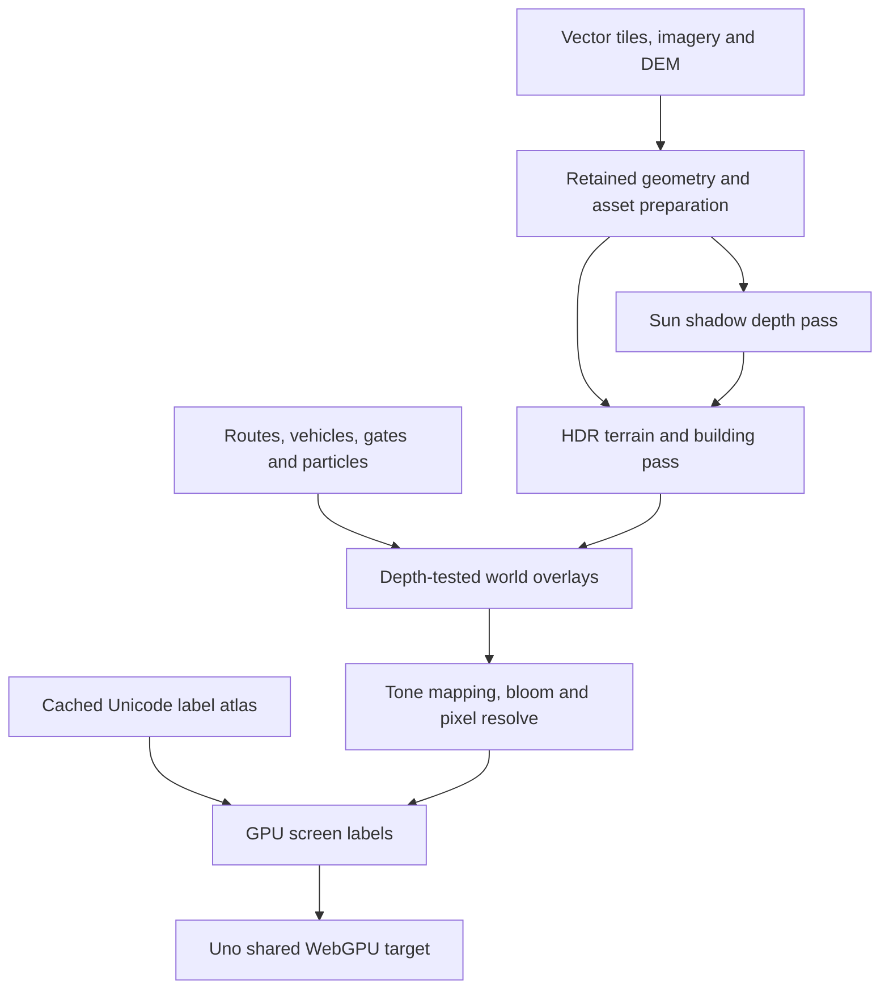

# Uno Platform 7 and native WebGPU migration

## Status and scope

This branch migrates Pixel Atlas from Uno.Sdk 6.7.30 to Uno.Sdk 7.0.5 and replaces
every production map presentation path with Uno's shared-device
`WebGpuCanvasElement`. The Uno UI also uses the WebGPU graphics provider.

The source implementation is present. Native regression validation has passed;
the published browser integration and visual-quality gates are still being
worked through. The quality target is a modern real-time 3D renderer. Implemented
graphics features do not by themselves establish commercial AAA visual quality,
hardware frame rates, or a measured improvement over the previous release.

## Verified dependency graph

| Dependency | Previous | Migration |
| --- | --- | --- |
| Uno.Sdk | 6.7.30 | 7.0.5 |
| Uno core / graphics | 6.7.135 GL add-in | 7.0.32 core, Composition.WebGpu and Graphics3DWebGpu |
| .NET SDK used for verification | 10.0.403 | 10.0.403 |
| Target frameworks | net10.0 / net10.0-browserwasm | unchanged |
| Browser bootstrap | driven by Uno 6 SDK | 10.1.1 from Uno 7 SDK |
| SkiaSharp asset processing | 3.119.2 | 4.151.1, managed and native aligned |
| Silk rendering API | OpenGL 2.16.0 | WebGPU 2.23.0 |
| GL reference tests | production renderer | test-only OpenGL 2.23.0 dependency |

Uno 7 removes the old native rendering hosts. All Uno-dependent projects are
rebuilt against the new SDK. No Uno 6 graphics package or Silk.NET.OpenGL
dependency remains in the production graph.

Authoritative upstream references:

- [Uno 7 migration guide](https://platform.uno/docs/articles/migrating-to-uno-7.html).
- [WebGPU rendering backend](https://platform.uno/docs/articles/features/using-webgpu-rendering.html).
- [WebGpuCanvasElement](https://platform.uno/docs/articles/controls/WebGpuCanvasElement.html).
- [Uno.Sdk 7.0.5](https://www.nuget.org/packages/Uno.Sdk/7.0.5).
- [Released canvas source](https://github.com/unoplatform/uno/blob/7.0.32/src/AddIns/Uno.WinUI.Graphics3DWebGpu/WebGpuCanvasElement.cs).
- [Released browser device initialization](https://github.com/unoplatform/uno/blob/7.0.32/src/Uno.UI.Composition.WebGpu/ts/Runtime/WebGpuInit.ts).

Uno explicitly describes its WebGPU backend as experimental. This migration uses
published APIs and pinned releases, rather than private host reflection.

## Host and control migration

The application and control library declare `Skia;WebGpu`. SkiaSharp remains
necessary for CPU image decoding, cached map artwork and glyph-atlas generation.
The host registers **only** `WebGpuBackend.CreateGraphicsProvider()`. There is
no Skia UI provider or CPU/GL map fallback selected at runtime.

The previous implementation depended on private Uno 6 browser renderer types,
native GL resolver interception, and either same-context Skia texture adoption
or a separate GL canvas followed by framebuffer transfer. The migration removes:

- `GpuTerrainSurface.cs` and its alternative presentation paths.
- `BrowserGpuContext.cs`, `BrowserGpuSurface.cs` and `BrowserGpuReadback.cs`.
- `pixel_map_gl_readback.c`, the native compile item and resolver linker flag.
- The `GLCanvas` feature and old Graphics3DGL add-in reference.
- Production compilation of `GlMapRenderer.cs` and `GlMapShaders.cs`; these
  files are linked into the test assembly as historical regression references.

`PixelMapControl.MapSurface` now derives from `WebGpuCanvasElement`.
`WebGpuMapRenderer` receives Uno's `context.Api`, borrowed device and queue.
It renders into the supplied texture view. No second browser graphics context,
texture-to-CPU copy, image upload for final presentation, or full-frame CPU
overlay bitmap participates in the production path.

The public `IsGpuRenderingEnabled` switch was removed. Its replacement is
`RenderingQuality` with `Balanced`, `High` and `Ultra` values.
`IsGpuRenderingActive` remains a read-only status indicator. The View menu
exposes the three quality choices and the four existing rendering styles.

## Render pipeline

### Geometry, precision and depth

Terrain uses retained height/artwork texture arrays, instanced patch data, and
shared grid or block index buffers. Buildings retain 32-byte vertices and model
storage buffers. The scene uses camera-relative transforms to avoid geographic
coordinate precision loss. Perspective clipping and depth mapping follow the
existing camera and terrain conventions.

A `GpuMapFrame` owns immutable geometry/source references. Controls advance
the displayed frame and the interaction/picking state together. Existing sparse
CPU depth queries remain available for label visibility, picking and terrain
interaction without reading a GPU depth buffer back to the CPU.

Each frame uses a 512-byte aligned uniform slot; building draws select their
slot through a dynamic offset. Terrain instances occupy 80 bytes.
Resource limits come from the actual shared device. Unsupported limits result
in an explicit diagnostic instead of an invalid draw.

### Lighting and image quality

Normal and Roblox styles implement:

- A directional sun shadow map with 3 × 3 percentage-closer filtering.
- GGX-based material lighting and sky illumination.
- A linear-light RGBA16F scene target.
- Height-dependent atmospheric fog.
- ACES-fit tone mapping and a small bright-pass bloom resolve.
- Quality-dependent multisampling and edge antialiasing.
- Correct final encoding for linear and sRGB target formats.

The shadow projection is a single stabilized sun projection, not a cascaded
shadow system. Terrain and building geometry supply the shadow casters. Vehicle
and route overlays use hardware scene depth; they do not currently cast or
receive the full physical-lighting shadow treatment.

Pixel and Minecraft retain their logical pixel grid, palette treatment, window
details and nearest-neighbor resolve. Their prior baked ground-shadow appearance
is retained. Smooth styles disable the old baked shadow so it is not doubled
with the new sun pass. Primitive-edge and color-rounding differences from the
GL renderer are possible; full-frame bit identity has not been claimed.

| Quality | Smooth geometry samples | Sun map | Requested scene-pixel cap | Bloom |
| --- | --- | --- | --- | --- |
| Balanced | 1 | 1024 × 1024 | 2,073,600 | off |
| High (default) | 4 | 1536 × 1536 | 3,686,400 | enabled |
| Ultra | 4 | 2048 × 2048 | 8,294,400 | enabled |

The actual smooth resolution is constrained by both the pixel cap and a
256 MiB attachment budget. Ultra may therefore render below its requested pixel
cap, particularly with multisampling. Physical display density is included;
logical projection coordinates remain unchanged. Pixel styles preserve the
logical grid; Balanced alone may increase their moving pixel size under CPU
submission pressure.

### Native scene overlays

`WebGpuSceneOverlay` produces 48-byte vertices and indexed triangle streams for
three batches: ordinary depth-tested world geometry, occluded navigation
silhouettes, and full-resolution labels after tone mapping.

Routes retain provider-distance progress, terrain draping, wrapped world copies,
antimeridian handling, stop flags and checkpoint gates. Walking, bicycle, car,
boat, train and aircraft models retain physical and miniature representations.
World effects use a fixed 56-particle buffer and preserve pause, seek, teleport,
resume and continuity behavior.

Labels reuse the existing Unicode placement, ordering, collision and occlusion
rules. A bounded 2048 × 2048 atlas caches font assets; only changed atlas regions
are uploaded. Labels are GPU quads, not a rasterized viewport overlay.
`PrepareGpuFrame(..., prepareLegacyOverlay: false)` avoids recording the old
Skia label display list. The default parameter remains true for regression
callers that exercise the historical renderer.

## Retention, ownership and failure handling

The map does not release Uno's API, device, queue, target texture or target view.
It owns and releases its own GPU buffers, views, textures, samplers, bind groups,
pipeline layouts, pipelines, shader modules, encoders and command buffers.

The target is valid only during `RenderOverride`. Resize recreates the
extent-dependent attachments. Unload releases scene resources and GPU resources
through the canvas lifecycle. Partial initialization cleans up explicitly because
Uno does not invoke `OnDestroy` when a derived `Init` throws.

Retained mesh storage is bounded to 128 MiB. Intermediate attachments are bounded
separately to 256 MiB. Tile arrays, atlas storage, uniforms, pipelines and driver
allocations are additional. `ResidentBytes` is a bounded-resource estimate, not
total process or GPU-driver memory; `AttachmentBytes` is reported separately.

Unavailable WebGPU, absent adapters, startup exceptions, uncaptured GPU errors
and device loss show an accessible HTML recovery panel with a reload action.
This panel does not depend on the failed GPU device. A forwarding observer on
the standard browser `requestDevice` API adds loss/error listeners to the
device Uno creates; it does not request another device or replace Uno's native
callbacks. Intentional page teardown suppresses that diagnostic.

## Verification and evidence

### Passed

The restored package graph matches the versions above. Rendering-library Release
compilation succeeded. The full native regression job also passed on GitHub for
[7d8b6f4](https://github.com/wieslawsoltes/UnoPixelMap/commit/7d8b6f4748d37fd2c606c061e577bd2cd8810bb3):
[workflow run](https://github.com/wieslawsoltes/UnoPixelMap/actions/runs/43105401404).

That job includes data, elevation, imagery, routing, simulation, input and audio
checks; the complete CPU rendering corpus; and the retained GLES reference
renderer. Selected corpus sizes include 11,935,261 sparse/eager depth queries,
9,063,600 projected depth comparisons, 1,122 physical-camera building-cache
poses, 24 exact label fixtures and 16 real Manhattan label views. These validate
preserved geometry/interaction behavior and the reference renderer, not the new
WebGPU scene's entire raster output.

The new `--webgpu-overlay` checks passed locally: Unicode atlas/halo composition,
all six vehicle modes across four styles, route and gate geometry, antimeridian
and near-plane clipping, finite vertices, valid indices, atlas reuse, particle
capacity and lifecycle. Follow-up checks cover retained-frame reactivation and
idle timestamp advancement.

Exact production WGSL and 22 pipeline variants were accepted by native Dawn
validation on SwiftShader. This is shader/layout validation only.

### Unresolved during validation

The first native complete-frame fixture aborted in SwiftShader after submission.
A sky-only variant also aborted, while independent clear and constant-triangle
fixtures succeeded. No complete-frame native screenshot or timing is established
by that run. The local execution environment then became unavailable; the
implementation commits had already been saved in the PR. Published browser CI
is the authoritative integration gate and is still being investigated.

The WebGPU browser suite observes actual shader compilation, pipeline depth
and multisample state, map queue submissions and readback calls. Its intended
coverage includes all styles/quality presets, imagery/elevation/relief, pan/zoom,
all six route demonstrations, walking, resize, high-DPI mobile pinch, unavailable
WebGPU and device loss. It retains screenshots, errors and bounded counters.
The suite must pass before this migration is considered ready.

`frameMilliseconds` measures CPU preparation and submission.
`submissionMilliseconds` measures renderer-side CPU work. Neither is a GPU
completion measurement or display FPS. No hardware speedup is asserted.

## Historical tests and remaining quality boundaries

The old GL/compositor/readback benchmark workflow and CPU/GPU browser matrix are
retired because they observe APIs removed by this migration. Their source and
previous evidence remain available for historical comparisons. They are not
valid WebGPU benchmark results.

The renderer does not implement cascaded shadows, temporal antialiasing,
screen-space reflections, global illumination, volumetric clouds, photogrammetric
city assets, or GPU-driven streaming/culling. Map content is still derived from
the existing vector, imagery and elevation providers. A future AAA acceptance
gate must specify target hardware, scene/content quality, frame-time percentiles,
memory limits and visual baselines. This migration supplies concrete shader and
resource infrastructure without declaring those broader targets already met.
