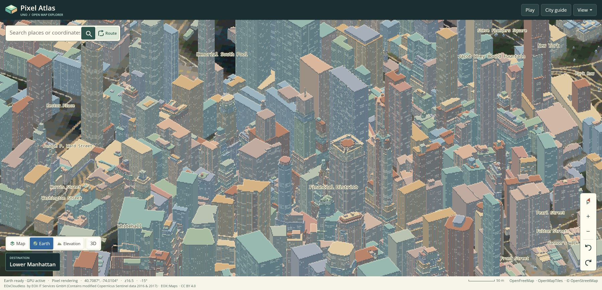

# Browser evidence for source release 555990d

All four jobs in [workflow run 42696985047](https://github.com/wieslawsoltes/UnoPixelMap/actions/runs/42696985047)
completed successfully. This directory preserves the source package identities,
functional browser checks, complete timed probes and all 14 separately captured
CPU profiles. The deployed source is `555990d0e086ffb9908d4d98ec30a73a245a6c6e`;
the baseline is the exact `53e9c684a45ff1224c91ebeeefbb4d321c1c8c8b` Pages artifact
from run `42415166135`, measured again on the current runner.

## Result and scope

The browser results are mixed and do not show a general play-mode throughput
improvement. First-person walking is essentially unchanged. Walking chase and
first-person driving have lower map submission rates in both candidate repetitions.
Driving chase consumes less task CPU time in both repetitions; its aggregate map
submission rate is 1.10% lower, with individual rates moving in opposite directions. The native Earth preprocessing improvement is a separate result:
these moving browser workloads use the Map layer.

| Moving workload | Main-thread CPU occupancy, baseline → candidate | Submitted map images/s, baseline → candidate | Submission-rate change |
| --- | ---: | ---: | ---: |
| Walking, first person | 26.29% → 26.80% | 5.623 → 5.622 | −0.025% |
| Walking, chase | 32.08% → 32.85% | 9.209 → 8.911 | −3.24% |
| Driving, chase | 46.09% → 43.44% | 6.123 → 6.055 | −1.10% |
| Driving, first person | 43.07% → 42.02% | 4.206 → 3.932 | −6.51% |
| Free flight | 35.34% → 35.72% | 4.866 → 4.747 | −2.46% |

CPU occupancy weights each repetition by its `Performance.getMetrics` interval;
submission rates weight by the actual probe interval. These denominators differ,
and the metric interval includes probe-result transfer. Neither value is a
physical display FPS measurement. The raw reports also retain main-thread task
milliseconds, rAF rates and per-repetition distributions.

| Workload | Map-submission p95, baseline repeats → candidate repeats (ms) | rAF p95, baseline repeats → candidate repeats (ms) |
| --- | ---: | ---: |
| Walking, first person | 250.4 / 247.4 → 242.2 / 247.9 | 16.8 / 16.8 → 16.8 / 16.8 |
| Walking, chase | 187.9 / 189.3 → 207.8 / 195.7 | 16.8 / 16.8 → 16.8 / 16.7 |
| Driving, chase | 371.6 / 438.9 → 427.4 / 474.0 | 16.8 / 16.8 → 16.8 / 16.8 |
| Driving, first person | 384.4 / 435.1 → 369.4 / 424.1 | 50.0 / 50.0 → 50.0 / 50.0 |
| Free flight | 346.0 / 428.9 → 371.1 / 403.4 | 16.8 / 16.8 → 16.8 / 16.8 |

First-person driving's pooled median submission interval is 237.1 → 260.7 ms;
its pooled submit-to-fence-signal p95 is 539.2 → 594.8 ms. Its lower map-submission
p95 therefore does not imply higher throughput or lower latency everywhere.
Baseline driving-first-person distances are 153/152 m and candidate distances are
170/158 m. Walking-chase distances match at 14/13 m. The data cannot attribute an
end-to-end change to one patch without a fixed-trajectory replay.

All 959 measured submissions use the compositor: 484 baseline and 475 candidate.
Every submission has the same 300 × 166 artwork size and pixel size 4. Both variants
have zero `readPixels` calls, zero buffer readbacks and PBO copies, at most two
outstanding direct frames, and zero premature releases, overwrites or abandoned
transfers. All stationary windows have zero map submissions. A single stationary
pair is not a reliable latency or CPU performance study.

The benchmark uses Chromium 156.0.8078.4 with SwiftShader on an AMD EPYC 7763 runner,
affinity `0,1,2`, a 1200 × 780 viewport and DPR 1. The environment and harness hashes
are retained verbatim. The functional verification job is a separate runner (its
visual reports identify an AMD EPYC 9V74); its timings are not mixed into the
performance comparison. Hardware GPUs, Safari and iOS are outside this measurement.

## Files and reproduction

- `provenance.json` and `environment.json` are unmodified workflow exports. They
  identify both Pages artifacts, all boot-resource hashes, execution order and
  the pinned browser/harness.
- Each `baseline/` and `candidate/` repetition retains the original `report.json`
  and raw probe JSON under deterministic `.gz` compression. The 14 raw CPU
  profiles captured after timing are retained as `.cpuprofile.gz` files.
- `analysis.json` contains all 30 audited records, weighted aggregates, both
  repetitions and pooled distributions. `samples.csv` is the same per-run data in
  tabular form. `analyze.py` reconstructs both from the raw probes and checks the
  source identities, shared harness, exact execution order and recorded metrics.
- `presentation-comparison.json`, `presentation-direct.json.gz` and
  `presentation-detached.json.gz` preserve the six pixel-exact compositor/transfer
  comparisons. `high-dpi-close-camera.json.gz` retains nine close-camera checkpoints
  and zero failures.
- `validation.json` identifies the completed jobs and artifact ZIP digests, links
  their check excerpts, and records the live-site smoke check. `manifest.json`
  includes compressed and decoded SHA-256 values for the preserved files.

Run the auditor from the repository root. The output directory is independent of
the retained evidence; the auditor accepts either these compressed files or an
unpacked workflow artifact.

```sh
python3 docs/verification/browser-rendering-555990d/analyze.py \
  docs/verification/browser-rendering-555990d \
  /tmp/unopixelmap-browser-audit-555990d
```

The two generated files reproduce the committed `analysis.json` and `samples.csv`
byte for byte. Quantiles follow the browser harness: the sorted upper-middle
sample is the median, and p95 uses index `min(n - 1, floor(n × 0.95))`. Pooled
intervals concatenate intervals within each repetition; no cross-process interval
is invented. Profiling happens after timing, so profile weights are not invocation
counts and cannot establish the cause of a throughput change.

## Candidate profile diagnostics

[The symbolicated candidate profiles](candidate-profiles-symbolicated.zip) use the
exact published native WASM, all 66 Webcil assemblies and the existing repository
symbolicator. The input archive, script, native module and extracted resource
hashes are retained in [profile provenance](candidate-profile-provenance.json).
Six profiles contain native WASM frames that can be renamed; the idle-relief
profile contains only root/program/idle nodes and remains byte-for-byte unchanged.

[Validation](candidate-profile-validation.json) independently confirms that only
node function names changed: node IDs, edges, timestamps, samples and time deltas
remain identical in all seven outputs. Ordinary MethodDef AOT slots are named;
generic extras and native/runtime functions can remain anonymous. Folded aliases
are preserved because a sample cannot distinguish them.

[Sampled hotspots](candidate-profile-hotspots.json) retain both self and inclusive
weights. Terrain texture baking and label visibility work are substantial in the
captured active profiles. These are separate candidate-only profiling windows,
not the throughput windows, and they cannot causally explain the paired changes.
The bundle includes the exact script and invocation for reproduction with the
original Pages artifact.

## Live deployment

The live page loaded the checked
`package_f94afc049db9913efe870a82a5ee049f4bcd7cfd07814383e5e445612de13355`
bootstrap. The screenshot shows the deployed Earth layer with GPU-active Pixel
rendering; it is a visual smoke check using live providers, not a deterministic
pixel oracle or performance run.


