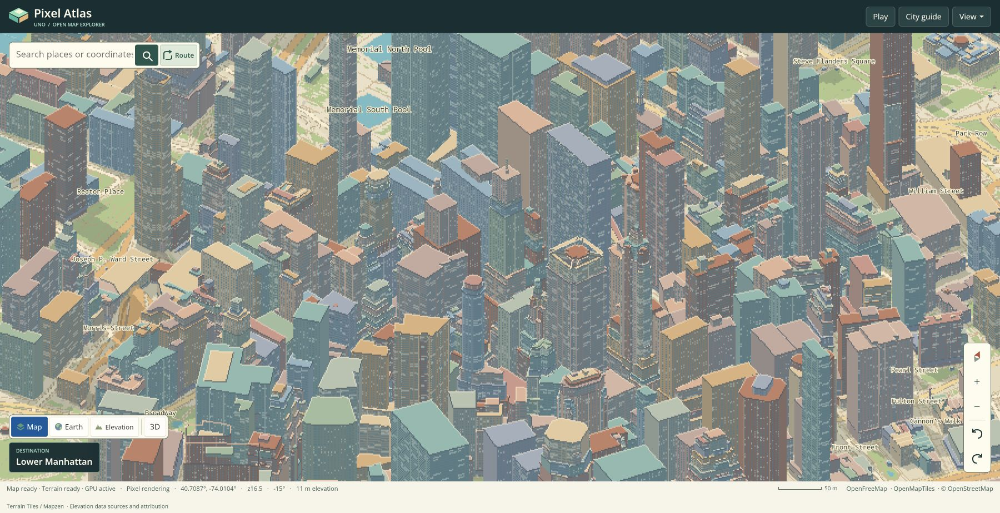

# Browser evidence for source release dbde48e

Source [`dbde48e9fd5318ef309bf31ed4b9b7e1596ec7d6`](https://github.com/wieslawsoltes/UnoPixelMap/commit/dbde48e9fd5318ef309bf31ed4b9b7e1596ec7d6)
passed all four jobs in [run 42907891884](https://github.com/wieslawsoltes/UnoPixelMap/actions/runs/42907891884):
native/build/package checks, functional Chromium validation, the paired benchmark
including exact camera replay, and Pages deployment. The live page loaded the
same checked package. Later documentation commits do not change that deployed
source identity.

The baseline is the exact `555990d0e086ffb9908d4d98ec30a73a245a6c6e` Pages artifact
from run `42696985047`, measured again on the current runner. No timing from its
earlier runner is reused.

## Result and limits

**The exact-camera workloads use less main-thread CPU per input and reach their
first map submission sooner.** All five moving held-key workloads also record
lower Task CPU across their two-process summaries. Submitted-map throughput is
mixed: first-person walking and chase driving are slightly lower. The result is
not a general physical-FPS claim, and the measured hardware uses a software GPU.

The release combines early, permanent Boolean label-occlusion proofs with exact
integer copying of eligible opaque terrain textures. Their separate native
experiments are retained in the [visibility](../occlusion-20261110/README.md) and
[terrain-copy](../terrain-copy-20261110/README.md) evidence. The combined browser
comparison does not isolate either patch's individual contribution, and native
percentages must not be added to browser percentages.

## Exact submitted-camera replay

Each scenario uses four fresh processes in baseline/candidate/candidate/baseline
order. Every process receives the same 32 trusted native wheel inputs. The
contract keeps every resulting map submission, all projection values, draw
counts, artwork dimensions and terrain-instance transforms in their original
order. Each frame must observe its own signaled fence. A step then waits at least
250 ms without another resolve and two animation frames before advancing.

All **384 inputs and 408 individually fenced submissions** pass. Pan produces
34 frames per process, orbit 32, and paused first-person look 36; the extra frames
are retained tile-refresh submissions. All nine comparisons against the first
baseline report pass exactly. Sequence hashes also agree with the separately
validated [same-artifact preflight](../camera-replay-preflight-20261110/README.md).
The smallest completed quiet interval is 284.2 ms. No frame was sorted, merged,
discarded or accepted under a projection tolerance.

| Controlled workload | Task CPU/input, baseline → candidate | Change | First-submission median, baseline → candidate | Change |
| --- | ---: | ---: | ---: | ---: |
| Map pan over relief | 74.916 → 58.652 ms | −21.71% | 24.95 → 21.30 ms | −14.63% |
| Map orbit and tilt | 101.214 → 67.089 ms | −33.72% | 31.40 → 28.40 ms | −9.55% |
| Paused first-person look | 111.701 → 69.496 ms | −37.78% | 72.85 → 39.85 ms | −45.30% |

These are medians across the two process values per variant. For latency, each
process contributes its own 32-input median. They are not pooled samples or
confidence estimates. CPU includes the observer and automation work. Paused look
does not measure locomotion, and the barriers prevent interpreting these values
as maximum throughput or FPS.

| Controlled workload | Process-p95 first submission, baseline → candidate | Process-p95 final observed fence signal, baseline → candidate |
| --- | ---: | ---: |
| Map pan | 151.15 → 62.35 ms | 2,016.60 → 1,952.70 ms |
| Map orbit | 235.05 → 75.85 ms | 1,241.60 → 1,089.55 ms |
| Paused first-person look | 268.05 → 117.25 ms | 456.05 → 338.30 ms |

Each cell above is the median of the two process-p95 values. All three latency
series' medians, p95s and maxima improve in each paired repetition. Improvement
is not uniform at every input: first submission is slower in 12/64 pan, 11/64
orbit and 11/64 paused-look matched samples. Final-fence observation is slower
in 19/64, 20/64 and 9/64 respectively. The independent audit retains each
adverse step and all process values.

Fence latency is **application-observed polling delay**, including the polling
schedule and SwiftShader execution. It is not a hardware GPU timer or visible
presentation latency. In particular, the roughly one-second map fence values
do not establish one second of visible map lag. First-submission and Task CPU
results have their own distinct meanings. Exact projection identity proves the
submitted workload; separate rendering oracles establish pixel correctness.

## Moving and stationary play workloads

The original 30-process benchmark remains separate: five stationary AB pairs
and five moving ABBA comparisons. Each timed window requests 8,000 ms; the exact
probe and CPU-metric intervals are retained. Task CPU is the main-thread
`TaskDuration` delta. CPU occupancy uses the CDP `Timestamp` interval, including
probe-result transfer. Map rates use resolve counts divided by the probe's
capture duration. These denominators are not interchangeable.

| Moving workload | Task CPU, baseline → candidate | CPU change | Submitted maps/s, baseline → candidate | Rate change |
| --- | ---: | ---: | ---: | ---: |
| Walking, first person | 2,554.26 → 2,443.66 ms | −4.33% | 8.985 → 8.809 | **−1.95%** |
| Walking, chase | 3,381.87 → 3,160.36 ms | −6.55% | 13.452 → 14.042 | +4.38% |
| Driving, chase | 4,165.60 → 3,378.86 ms | −18.89% | 9.866 → 9.666 | **−2.03%** |
| Driving, first person | 3,560.23 → 2,837.00 ms | −20.31% | 7.196 → 7.684 | +6.78% |
| Free flight | 2,791.83 → 2,620.19 ms | −6.15% | 10.308 → 10.682 | +3.63% |

Each entry is the median across the two process observations, hence their
arithmetic mean. Every candidate moving Task CPU observation is below both
baseline observations for that scenario. The submission-rate results remain
mixed; chase driving's median submission interval increases from 89.95 to
96.60 ms even though its p95 decreases. Flight's second candidate repetition
has fewer submissions per second than both baseline repetitions.

First-person driving's rAF p95 changes from 33.3 to 16.8 ms across process
summaries. rAF measures browser callbacks, while the map rate counts submitted
map images; neither is physical display FPS. Observed held-key fence p95 rises
4.31% for first-person walking and 16.49% for free flight. Those distributions
are capture-censored: signals for earlier frames can appear, while tail
submissions may not signal before capture ends. Their IDs and counts are
retained, rather than treating every observed signal as an in-window completion.

Trajectories also differ. Chase-driving distances are 175/174 m for baseline
and 179/177 m for candidate; first-person driving is 161/156 versus 154/155 m.
First-person walking remains 12/12 m in both variants, but equal rounded HUD
distance does not prove identical submitted poses. Held-key results describe
end-to-end behavior; the camera replay supplies the separately checked exact path.

Stationary windows submit no map images. Their single-process CPU observations
include default-map idle 66.835 → 68.719 ms (+2.82%), stationary first-person
walking 349.14 → 381.39 ms (+9.24%), and stationary flight +0.15%. Relief idle
is −6.74% and stationary chase driving −3.92%. These increases are preserved;
one process per variant cannot establish a stable idle-performance change.

All **1,614 timed map submissions** use the compositor: 799 baseline and 815
candidate. Every submission remains 300 × 166 art pixels at pixel size 4.
Both variants have zero map `readPixels` calls, zero pixel-pack copies or pending
PBO readbacks, at most two pending direct frames and no release before a signal.

## Environment and correctness

Both variants run in Chromium **156.0.8078.4**, SwiftShader, on one AMD EPYC **9V45**
runner with CPU affinity **0–2**, viewport **1200 × 780**, DPR **1**, and identical
harness/browser flags. SDK **10.0.403** and .NET/WASM **10.0.14** match the retained
baseline toolchain. All 66 managed assembly versions agree. The linked SkiaSharp
module retains additional pixel-access wrappers required by the new copy path;
its dependency version is unchanged. [Package comparison](package-wasm-comparison.json)

The [independent functional audit](functional/README.md) verifies six presentation
pairs across Pixel, Normal, Minecraft, Roblox, Earth overhead and elevation:
**1,782,000 map pixels** and **5,616,000 full-canvas pixels** match exactly.
Those compare direct and detached presentation within the same candidate release.
The native cross-release GLES report separately preserves all 192 standard hashes.
CPU/GPU journeys and terrain, all five camera rigs, pointer lock, gestures,
touch takeover, four styles and nine DPR2 close-camera checkpoints pass.

The [profile archive](profiles/README.md) preserves all 14 separate diagnostic
passes, naming normal AOT methods from the exact package modules. All 92,416
samples and time deltas remain unchanged; only node names are replaced where
resolvable. Profile weights are not timed-window costs or invocation counts.

## Evidence and reproduction

- `provenance.json` and `environment.json` are unmodified workflow exports.
  They identify both package artifacts, resources, execution order and harness.
- `baseline/`, `candidate/` and `camera-replay/` preserve every complete timing
  report/raw probe, all 14 raw profiles, process logs and camera comparisons.
  Deterministic gzip preserves original decompressed bytes.
- `analysis.json`, `samples.csv`, `replay-samples.csv` and `profiles.csv` retain
  all observations, both repetitions, distributions, signs and adverse cases.
  `measurements.md` is the generated numerical summary.
- `auditor/` contains the portable frozen-source reconstruction tools and their
  tested provenance. `replay-independent/` supplies the second camera audit.
- `functional/` retains exact original image bytes with an explicit deduplication
  map, complete logs/reports, artifact metadata and independent offline auditors.
- `profiles/` contains original and named profiles, exact symbolication tools,
  module/method identities, sampled stacks and structural validation.
- `workflow-*.json`, `validation.json` and the acquisition records retain completed
  run/job/artifact identities. `manifest.json` hashes the complete retained set,
  including compressed and decoded identities; `SHA256SUMS` also covers the manifest.

From the repository root, reconstruct the principal tables without launching a
browser or requiring .NET:

```sh
python3 docs/verification/browser-rendering-dbde48e/auditor/analyze.py \
  docs/verification/browser-rendering-dbde48e \
  /tmp/unopixelmap-browser-audit-dbde48e
```

The auditor validates all 30 timed processes, 14 profiles and 12 replays. It
checks exact source/artifact identities, reconstructs the published metrics,
and withholds a replay scenario's comparisons if any of its four captures fails.
The primary aggregate is the process median. The former weighted rates and
occupancy, plus pooled within-process distributions, remain available as
secondary summaries. Within-process medians use the harness's upper-middle
order statistic; p95 uses sorted index `min(n−1, floor(0.95n))`.

## Live deployment

The live page loads
`package_801cbc2830341569438a9ce8c44febc16626f1501278ed456482a888efe98347`.
The manual smoke check enabled terrain relief, entered first-person walking,
and returned to the map. The final state shows Map ready, Terrain ready,
GPU active and Pixel rendering. [Recorded observations](live-validation.json)

This screenshot uses public live providers and the browser's natural viewport.
It is a visual smoke check, not a deterministic image oracle or performance run.


