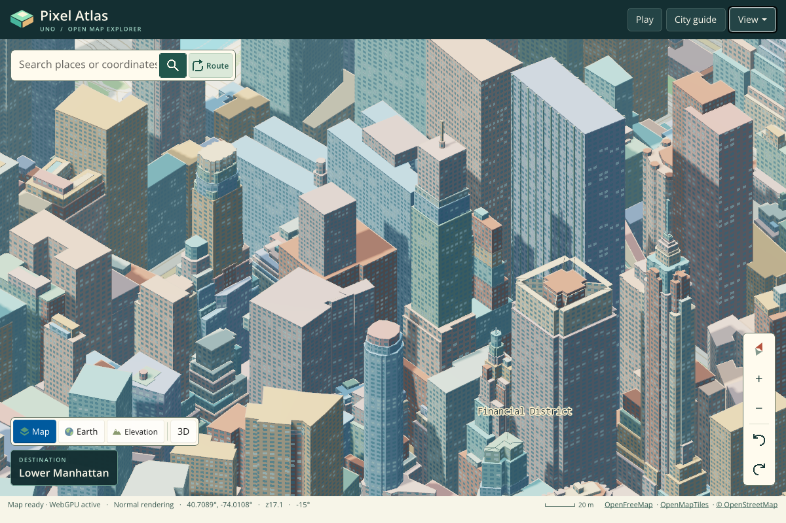
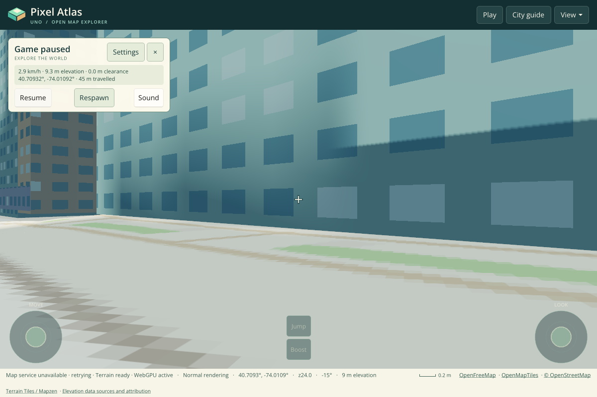
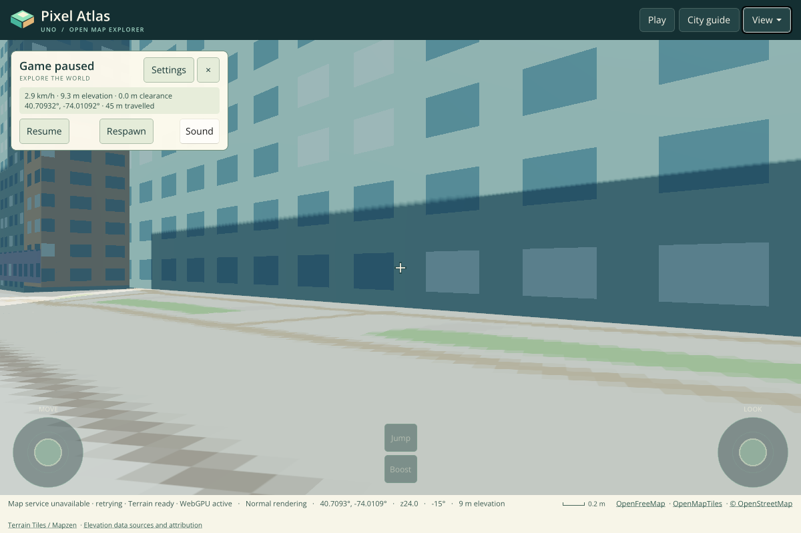

# Uno 7 WebGPU browser verification

**Passed: native regression, presentation preflight, and all 31 browser scenarios
in both Debug and Release AOT.**

This directory preserves selected original browser captures and diagnostics for
[source revision `dad16fcd65f8ceb67e43eed95c4af0ef9787609f`](https://github.com/wieslawsoltes/UnoPixelMap/commit/dad16fcd65f8ceb67e43eed95c4af0ef9787609f).
[Workflow run 15](https://github.com/wieslawsoltes/UnoPixelMap/actions/runs/43128831943)
checks out PR merge `78fdef7f0a1ef1147a960760eb7c9f4f0cf4dabd` against base
`c6a26075b5767e2aa82e87e949194e82c0e9cb1e`.

| Gate | Result |
| --- | --- |
| Native regression and WebGPU geometry/lifecycle checks | Passed |
| Independent CSS/WebGPU opaque-pixel presentation test | Passed |
| Debug publish, package identity and browser integration | Passed; 31 scenarios |
| Release AOT publish, package identity and browser integration | Passed; 31 scenarios |

Both reports contain `passed: true`, an empty error list and an empty failure
list. Package verification checks every boot resource and compressed
representation and repeats finalization twice without changing artifact bytes.

The final documentation commit adds this evidence without changing the tested
application, shaders or browser harness. [manifest.json](manifest.json) records
the CI jobs, artifact identities, original archive hashes, published package
identities and SHA-256 hashes of the preserved files. PNG and JSON files are
copied without changing their bytes. `debug-report.json` is the Debug artifact's
original `report.json`, renamed only to distinguish the two configurations.

## Rendered output

### Normal city view

This is the actual application and Uno UI captured from the published Release
AOT build. Terrain, buildings, labels and the UI are presented through WebGPU.

### Shadow quality at a fixed camera

| High | Ultra |
| --- | --- |
|  |  |

The camera is paused before switching quality. High uses two 1536² depth layers;
Ultra uses four 2048² layers. The GPU probe traces the actual textures and views
through encoded command buffers into submitted passes, requiring geometry draws
in every expected layer. The paired captures show the facade shadow at the same
position. Small finite-resolution PCF edge variation remains. Ground artwork
retains the source raster's texel density at street scale.

### Other preserved views

- [Night lighting and emissive windows](lighting-night.png).
- [Paused driving route and vehicle overlay](journey-drive.png).
- [Native-DPI mobile Normal view and Financial District label](mobile-normal-initial-high-dpi.png).
- [Native-DPI Normal rendering after touch pinch](mobile-normal-high-dpi.png).

The mobile browser uses DPR 2. Its 390 × 736 logical map viewport has a
780 × 1472 native map target and scene, inside a 780 × 1688 screenshot. Logical
layout, camera and input coordinates remain independent of native texture size.
Pixel style intentionally retains its enlarged artwork grid.

## Reports and interpretation

- [Release AOT scenario report](report.json) and [Debug scenario report](debug-report.json).
- [Release desktop GPU trace](desktop-gpu.json) and [mobile GPU trace](mobile-gpu.json).
- [High shadow capture trace](free-roam-walk-gpu.json) and [Ultra shadow capture trace](free-roam-walk-ultra-gpu.json).
- [Initial native-DPI label capture trace](mobile-normal-initial-high-dpi-gpu.json).
- [Post-pinch native-DPI capture trace](mobile-normal-high-dpi-gpu.json).

The final Release desktop probe records 837 map draws and 43 map submissions;
the mobile probe records 70 draws and 12 map submissions. Each application page
uses one shared device and records zero unexpected GPU errors, losses, map
readbacks or WebGL contexts. These are cumulative validation counters, not a
throughput comparison. In the separate deliberate-loss scenario, Release map
submissions remain 2 → 2 after destruction; Debug remains 3 → 3. Both receive
the managed device-loss diagnostic.

The scenarios cover all four styles and three quality presets, Day/Dusk/Night,
imagery, relief, elevation, pan/wheel, resize, free roaming, all six journey
modes, mobile pinch, native-density rendering, unavailable WebGPU and deliberate
loss of the actual shared GPU device. Journey captures require intermediate
progress and exactly unchanged progress while paused through GPU completion and
capture. Recovery must stop managed map submissions.

Screenshots wait for shader compilation queries, queue completion and browser
composition. An independent presentation preflight first verifies opaque CSS
magenta and WebGPU green pixels. Submitted commands alone are not accepted as
proof of displayed rendering. The application capture checks reject transparent
or blank output, recovery UI and unexpected GPU errors or losses.

The browser is full Chromium 156 under Xvfb, using Google SwiftShader's Vulkan
adapter for ANGLE and WebGPU. This establishes functional rendering on that
software implementation. It does not establish dedicated-GPU frame rates,
cross-browser support, temporal image quality or commercial AAA acceptance.
`frameMilliseconds` and `submissionMilliseconds` measure CPU work; they are not
GPU execution timings or display FPS.

The fixture uses bundled map data and blocks external providers. Its flight
origin can have unloaded airport ground, so the flight capture establishes
aircraft/route playback, not detailed airport terrain quality. The complete
temporary CI artifacts include all scenario images; the representative files
here remain available with the repository after those artifacts expire.

See the [migration guide](../../uno7-webgpu-migration.md) for the dependency graph,
resource ownership, render pipeline, quality budgets, native regression coverage,
investigations and remaining quality boundaries.
