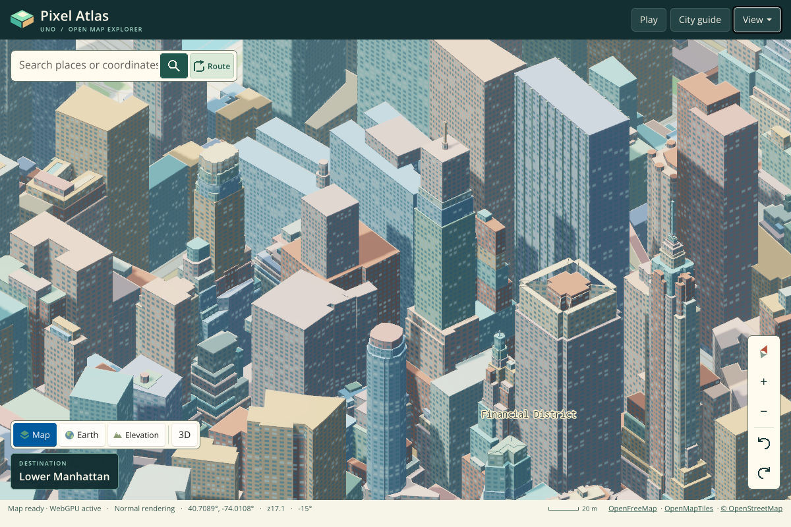
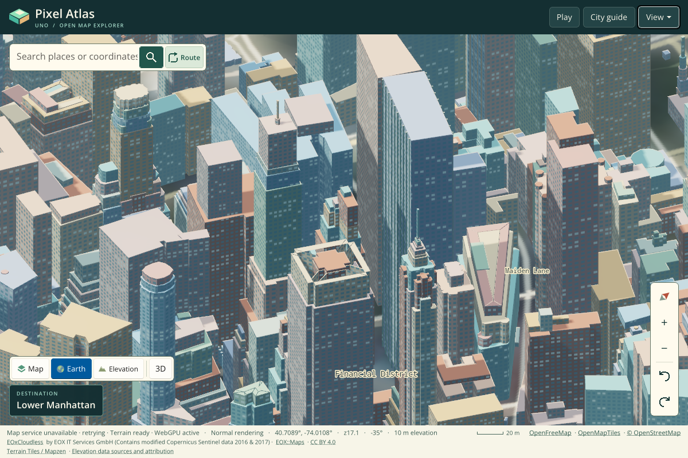
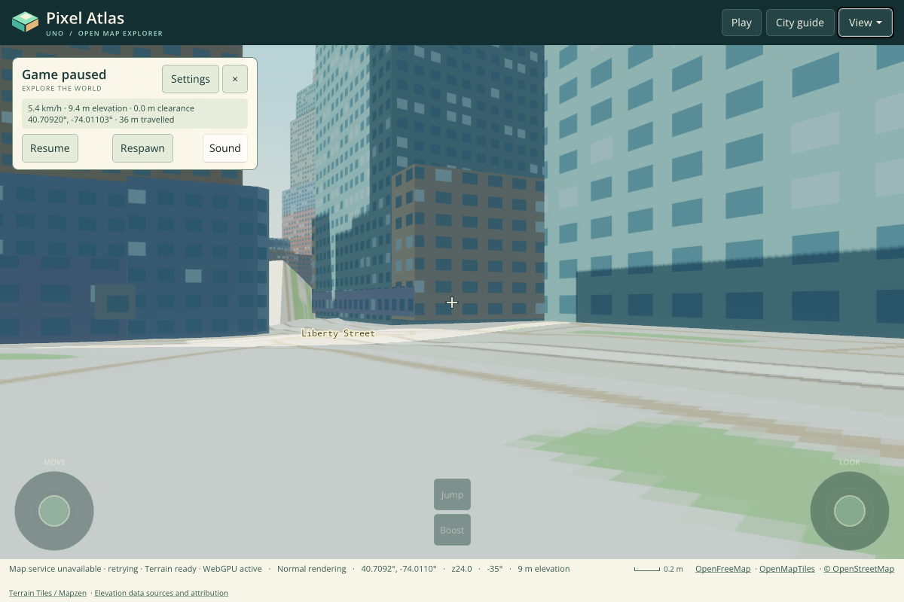
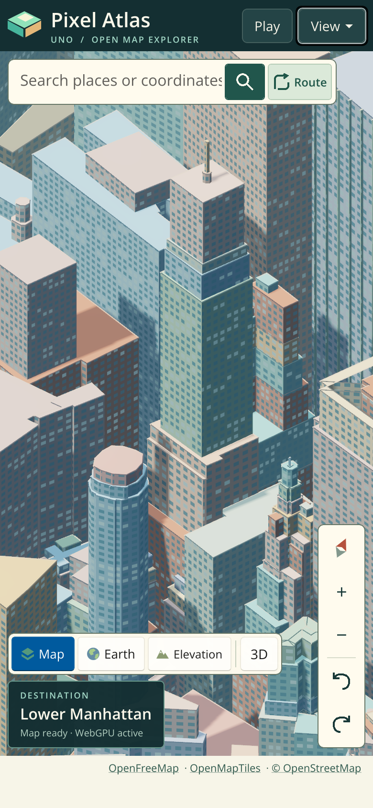

# Final-source WebGPU integration evidence

[Integration run 43263360196](https://github.com/wieslawsoltes/UnoPixelMap/actions/runs/43263360196) passed all **34 browser scenarios in Debug and all 34 in Release**. Each original report has `passed: true`, empty `errors`, and empty `failures`. This covers integration behavior, numerical shader fixtures, presentation, quality modes, terrain, free roam, journey modes, mobile input, unavailable WebGPU, and injected device loss.

The integration checkout was synthetic merge `d407757af166a61c6dd38d4008c4abfe37870d30`. Its Git tree and production head `4a3b9c412ab7bb114795a6d4e5281e97508f4d56` both equal `353460159fc607c7d4c3765a08259f5e0f33781f`. The `src` tree is `cf568d7832d23566d87b188f23f8afb18bab1d2a`; it is also unchanged in the following harness-only commit `cc1cc040a518cff8bbf310bfadaa2a0ef7ffab99`. This records source equivalence, without implying that these artifacts reran that subsequent harness.

## Preserved files and provenance

[manifest.json](manifest.json) records original artifact identifiers and SHA-256 hashes, every retained member's original path/size/hash, selected screenshot hashes, and source trees. [integration-reports.zip](integration-reports.zip) preserves **all 86 original JSON files** (43 per configuration), including complete reports, numerical fixtures, presentation checks, and all 39 GPU trace snapshots per configuration. Payloads are unchanged; only deterministic ZIP packaging and a `debug/` or `release/` path prefix were added. Member order, timestamps, permissions, and compression are fixed, and a second build produced identical ZIP bytes.

| Original artifact | ID | Bytes | SHA-256 |
| --- | ---: | ---: | --- |
| Debug | 13964789765 | 19,443,119 | `ad2b072239ac87cf82da03eca4115c17f70e602e5c4236ef29df46314313f994` |
| Release | 13966911809 | 19,403,982 | `b0053e29461646e84e052f0052431b4cb21d9578e5de6cfa80e69c962f17dba5` |

Both original ZIP hashes and sizes were verified before extraction, and retained bytes were compared with the originals. This committed bundle is an evidence subset: four unmodified Release screenshots are included below; the remaining screenshots and server logs are omitted. Each original archive contains 43 JSON files, 34 PNGs, and one server log.

## Command and quality checks

[audit.json](audit.json) is a derived, reproducible summary of the retained JSON. Both configurations show:

- **25 recorded desktop pipelines** in `desktop-gpu.json`; zero recorded GPU errors, render-graph errors, readbacks, losses, or WebGL contexts across the 39 GPU snapshots. The device-loss scenario deliberately injects loss separately; its retained GPU snapshot is taken before that injection.
- **Eight ordered compute/copy pairs** for the full contiguous 96-layer terrain batch in the final retained `style-normal-gpu.json` frame (submission 15). Each copy covers all 96 layers at one of mips 1–8. Sparse dirty batches can contain several contiguous runs and therefore more than eight copy commands.
- **High:** 4× scene MSAA, two sun-shadow passes, five bloom down passes and four up passes. **Ultra:** 4× scene MSAA, four sun-shadow passes, six bloom down passes and five up passes. Both final quality frames retain the nine-level sRGB terrain view and 8× anisotropic sampler.
- **Lighting fixture:** 11,232 cases and 33,696 compared channels, maximum absolute error zero; shadow comparison counters are 29,970 before and 16,092 after. These are numerical equivalence and algorithmic-work counters, not measured GPU-duration or full-frame speedup.

The trace stores bounded recent frames, so the command checks describe captured frames. The browser reports identify Chromium `156.0.8078.4` with ANGLE/Vulkan and SwiftShader. Their timing meaning is CPU preparation/submission only; software-GPU integration timing does not establish hardware FPS. A complete paired baseline/candidate browser latency result remains pending. These integration screenshots establish no baseline/candidate pixel identity or identity of every intermediate camera frame.

## Selected original Release screenshots

### Normal rendering

### Terrain relief

### Free roam, Ultra

### Mobile normal rendering at high DPI

