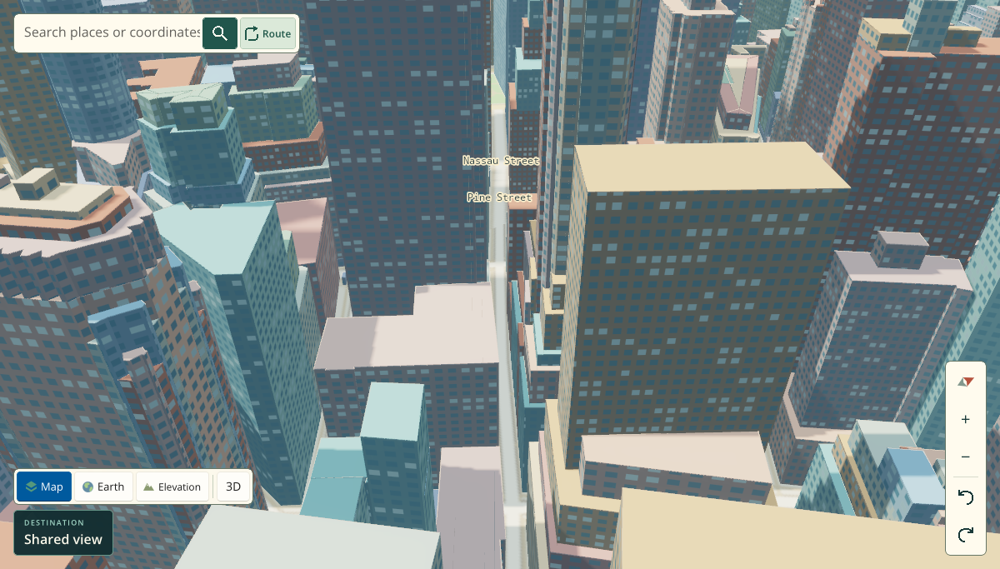
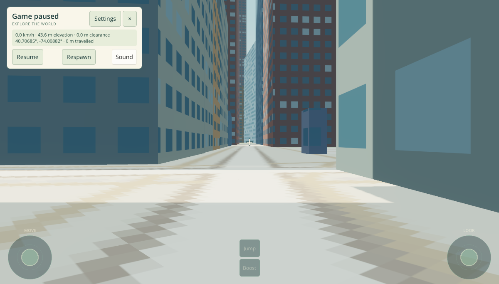

# Completed paired browser comparison — `f159983`

[Performance run 43405625411](https://github.com/wieslawsoltes/UnoPixelMap/actions/runs/43405625411) completed successfully. Its original [report.json](report.json) contains all four scenarios, 16 runs, and 128 serialized input steps. The comparison passed its input, endpoint camera/scene, image-tolerance, and GPU-health gates. **Timing results are mixed, with regressions retained alongside improvements.**

Baseline: `a9a284263da76a201114381467bf45aa4823a2d6`. Candidate and actual paired-job harness checkout: `f159983c68a72bd4fc8d27d592ba3721bf4689c3`. Both applications were published as Release AOT using .NET SDK `10.0.403`. The frozen head harness observed both applications on the same runner and Chromium `156.0.8078.4`, using the SwiftShader Vulkan software adapter, a 1200×800 viewport at DPR 1, and High quality. Each scenario used baseline 1 → candidate 1 → candidate 2 → baseline 2 order, with eight serialized inputs per run.

## Recorded timings

All table entries are **baseline → candidate, in milliseconds**, pooled across the 16 steps per variant/scenario. Managed render and submission values sum the corresponding managed CPU diagnostic durations for the frames attributed to each input; they exclude GPU execution. The browser harness uses the **upper-middle median** (ninth sorted value for 16 samples) and **nearest-rank p95**, which equals the maximum at this sample count. These conventions differ from the separately reported native benchmark's quantile implementation.

### Medians

| Scenario | Managed render CPU | Submission CPU | Input → first submit | Input → first queue callback | Input → last queue callback |
| --- | ---: | ---: | ---: | ---: | ---: |
| Pixel pan | 10.4 → 10.5 | 0.6 → 0.6 | 12.0 → 11.6 | 1928.2 → 1871.2 | 1951.6 → 1896.5 |
| Normal pan | 12.7 → 11.1 | 0.9 → 0.9 | 14.4 → 13.0 | 4011.3 → 3982.0 | 4041.3 → 4018.4 |
| Normal orbit | 12.5 → 10.8 | 0.9 → 0.7 | 14.4 → 12.8 | 4017.2 → 3836.4 | 4017.2 → 3836.4 |
| Paused walk/look | 18.8 → 18.3 | 4.0 → 3.6 | 18.3 → 19.5 | 3096.4 → 2900.4 | 3204.4 → 3077.8 |

### p95

| Scenario | Managed render CPU | Submission CPU | Input → first submit | Input → first queue callback | Input → last queue callback |
| --- | ---: | ---: | ---: | ---: | ---: |
| Pixel pan | 23.0 → 20.3 | 2.0 → 1.1 | 15.7 → 14.1 | 2031.6 → 1944.8 | 3903.5 → 3836.6 |
| Normal pan | 26.6 → 22.6 | 3.4 → 5.7 | 17.8 → 19.3 | 4091.8 → 4057.1 | 8192.1 → 8098.5 |
| Normal orbit | 17.6 → 15.5 | 1.5 → 3.8 | 21.8 → 17.4 | 4116.0 → 3899.7 | 4116.0 → 3899.7 |
| Paused walk/look | 29.7 → 33.4 | 9.1 → 7.0 | 24.9 → 25.8 | 3315.9 → 3129.5 | 6115.7 → 5765.0 |

Managed-render medians change by **+0.96% for Pixel pan**, **−12.60% for Normal pan**, **−13.60% for Normal orbit**, and **−2.66% for paused walk/look**. The walking input-to-first-submit median increases **6.56%** (18.3 → 19.5 ms); its render p95 rises 29.7 → 33.4 ms, and its mean render CPU rises 19.075 → 19.637 ms. Normal-pan input-to-submit p95 rises 17.8 → 19.3 ms. Submission-CPU p95 also rises for Normal pan (3.4 → 5.7 ms) and Normal orbit (1.5 → 3.8 ms). This two-repetition run supplies descriptive measurements, without statistical confidence bounds.

Queue callbacks include prior queue work and JavaScript callback scheduling; they are neither GPU timestamps nor display latency. Serialized steps measure input latency rather than sustained FPS. Each map scenario has **12/16 warm steps per variant**; paused walk/look has **0/16**. The remaining steps include texture uploads or resource allocations, so none of these pooled cases is entirely warm. Candidate-only preparation/overlay timings remain in the original report and are not invented for the baseline.

## Separate held-key samples

The paused walk/look comparison is followed by a separate approximately six-second moving phase. Its original samples are:

| Sample | Map submissions | Observed submissions/s | Start queue-prefix callback (ms) | End queue drain (ms) |
| --- | ---: | ---: | ---: | ---: |
| Baseline 1 | 4 | 0.665746 | 5500.6 | 11464.3 |
| Candidate 1 | 4 | 0.666067 | 4975.9 | 10026.3 |
| Candidate 2 | 4 | 0.666100 | 5063.7 | 10141.5 |
| Baseline 2 | 2 | 0.333145 | 8118.0 | 8006.5 |

These tiny counts and multi-second queue boundaries do not support a stable-FPS or 33% throughput-uplift claim. The raw files retain the actual durations, rAF intervals, uploads, submissions and HUD endpoints. The moving phase does not establish identical intermediate trajectories. SwiftShader observations establish software-adapter behavior; physical-GPU performance requires separate measurement.

## Image and physical-state checks

The independent [audit.json](audit.json) recomputed all four comparisons, 128 inputs, 152 managed frames/map submissions, 32 PNG hashes and 16 image pairs. All **16 before/after image comparisons** passed the frozen tolerance: at most 1% of pixels may differ by more than 2/255, with mean RGB channel error at most 0.25/255. The original comparisons report a maximum channel difference of 3/255 and a maximum significant-pixel fraction of `0.0000012201073694485115` (one pixel among 819,600). These are tolerance-based matches, not blanket byte or pixel identity.

The gates compare the same input trace, logical extent, before/after submitted projection, style, quality and scene geometry counts. Map cases also compare public physical-camera links; paused walking compares physical HUD telemetry. Full projection payload equality is established at the untimed before/after captures. Additional timed `lastDiagnostic` checks compare scene metadata/counts; they do not establish every intermediate submitted matrix, terrain transform, or geometry identity. The four original captures below show repetition 1 after the closed replay; walking is paused during that replay. All other originals remain in the archive.

| Normal orbit — baseline | Normal orbit — candidate |
| --- | --- |
|  |  |

| Paused walk/look — baseline | Paused walk/look — candidate |
| --- | --- |
|  |  |

## Preserved evidence and provenance

The original GitHub artifact is preserved as [part 1](browser-original.zip.part-01) (8,388,608 bytes) and [part 2](browser-original.zip.part-02) (4,221,230 bytes). Concatenating these consecutive byte ranges reconstructs the **unaltered original ZIP**, 12,609,838 bytes, SHA-256 `a1df72700e7a4232883d97723b3e2037eb67a3c0d4ec9743c7929b53cd7dd877`. The split accommodates the repository upload request-size limit; no archive member was rewritten or recompressed. All 54 members remain intact: the report, 16 raw run JSON files, 32 scenario PNGs, preflight reports/captures, and server log. The separate report and four visible PNGs are exact copies of archive members.

[artifact-provenance.json](artifact-provenance.json) records the successful run/jobs, original artifact metadata, package artifact identifiers/digests, checkout log lines, source trees and frozen harness provenance. [manifest.json](manifest.json) records every archive member's size/SHA-256 and every retained payload file's size/SHA-256; its own self-hash is excluded. The four files recorded by `report.harness` are frozen unchanged under [harness/](harness/), together with their original package metadata and lockfile. Their SHA-256 values match the report.

[integration-validation.json](integration-validation.json) is unchanged and records the separate successful current-head integration run: 34 Debug scenarios, 34 Release scenarios, and 61 successful steps. The candidate production `src` tree remains `cf568d7832d23566d87b188f23f8afb18bab1d2a`, matching the final production source already validated at `4a3b9c4`.

### Replay the comparison offline

From this directory, install the frozen dependencies once if they are unavailable locally, then extract the original archive and invoke the frozen comparator. This checks the saved measurements and original images; it does not start Chromium or rerun a benchmark. Application publish ZIPs are identified in the metadata and are not duplicated in this evidence bundle.

```sh
cat browser-original.zip.part-01 browser-original.zip.part-02 > browser-original.zip
printf '%s  %s\n' a1df72700e7a4232883d97723b3e2037eb67a3c0d4ec9743c7929b53cd7dd877 browser-original.zip | sha256sum -c -
npm ci --prefix harness --include=dev --ignore-scripts
perf_raw_dir="$(mktemp -d)"
unzip -q browser-original.zip -d "$perf_raw_dir"
node - "$perf_raw_dir" <<'NODE'
const assert = require('node:assert/strict');
const fs = require('node:fs');
const path = require('node:path');
const {PNG} = require('./harness/node_modules/pngjs');
const {compare} = require('./harness/webgpu-performance.cjs');
const directory = process.argv[2];
const report = JSON.parse(fs.readFileSync(path.join(directory, 'report.json'), 'utf8'));
assert.deepEqual(compare(report, directory, PNG), report.comparisons);
console.log('All four frozen comparisons and 16 original image pairs reproduced.');
NODE
```
